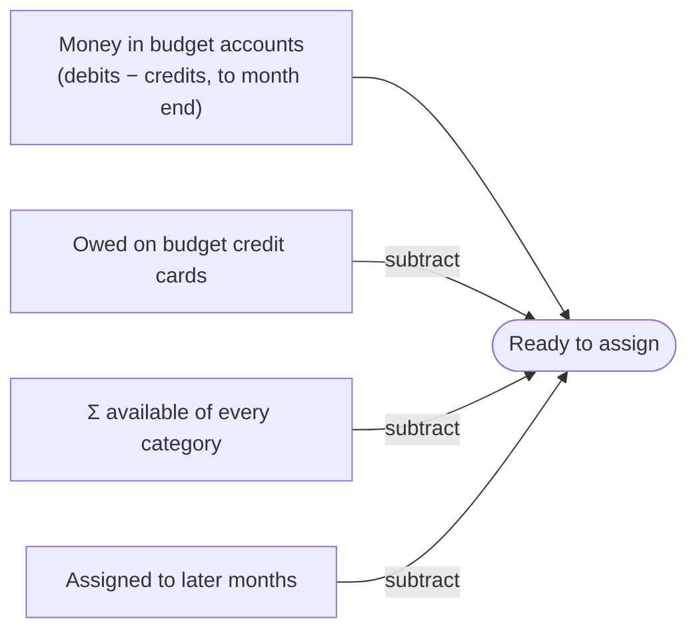

# The budget

finode uses **envelope budgeting** (the YNAB idea): every unit of money in your budget accounts gets a job. The budget sits **on top of the ledger without changing it**.

All of it lives in `backend/finode/services/budget.py` (`BudgetService`).

## What is stored, and what is not

Only these things are stored:

| Stored | Where |
|---|---|
| The plan: how much each expense category is *assigned* in each month | `budget_allocations` (user, month = first day, category, amount; unique per month and category) |
| Which accounts are part of the budget | nothing: every account of the four types is (`account_types.in_budget`) |

Everything else is **derived on demand** from postings and the plan, so editing a transaction can never leave the budget stale.

## The four numbers

For a month and an expense category:

- **Assigned** — what you gave the category this month.
- **Activity** — postings to the category in transactions that touch a budget account. An entry that touches no budget account (only a person's accounts) is not the budget's business.
- **Available** — what you can still spend:
  `max(0, last month's available) + assigned − activity`
- **Ready to assign** — money in budget accounts that has no job yet:
  `ready to assign = money in accounts − reserved for cards − Σ available − assigned to later months`

`BudgetRead` always satisfies that sum, and the page and the `get_budget` tool show it.

### Rolling month to month

`BudgetService._roll` carries the figures forward:

- Leftover money **carries into the next month**.
- An **overspent** category (negative at the end of a month) starts the next month at **zero**, and the deficit is taken out of *Ready to assign* from then on. In its own month an overspent category just shows negative and Ready to assign is unchanged. `overspent_last_month` reports what was deducted.
- Budgeting **starts with the first month anything was assigned**. Earlier spending is ignored, because cash is the balance *now* and past spending already left it; counting it would deduct it twice.
- Money assigned to **later months** is subtracted from Ready to assign in every earlier month, so assigning ahead uses up what is ready now, and the same money reads the same from either month.
- **Moving money** between categories (`move`, limited to what is available) never changes Ready to assign.
- A month's **assigned amount may be negative** to take back what an earlier month left in the category (Move money writes the same), but not by more than the category has left. Otherwise the category would show as overspent with nothing spent and Ready to assign would exceed the money there is.

## What Budgets is not

The Budgets page (then Plans) was once three sections, Spend, Build (money moved into funds and loans paid down) and Earn (expected income). Build and Earn were removed on 2026-10-22: moving money between accounts does not change net worth, only income does, and the envelopes already covered the rest. Migration `c4e6a8b0d2f4` dropped `accounts.saving` and the profile's section switches and deleted the plan rows of funds, loans and income accounts (the ledger was not touched). A fund or loan payment is budgeted as spending through the **category on its line** (nothing is filled in for the person). Savings goals (their own `goals` and `goal_allocations` tables and a **Goals** chip) came after and were removed on 2026-11-05; the identity is now `ready_to_assign = money_in_accounts − reserved_for_cards − Σ available − assigned to later months`.

## Budget accounts (2026-11-22)

| Kind of account | Effect |
|---|---|
| Bank Account, Cash, Prepaid Wallet | Its balance is the cash you can assign. |
| Credit Card | Purchases count as category spending the day they are made; the debt is subtracted from cash and shown under **Cards to pay**. |

Every account is one of these four and part of the budget; there are no tracking accounts, no net worth, and no investment or loan accounts. An EMI, a SIP or a deposit is spending in its category; money borrowed into the bank is income under Borrowed, an investment sold income under Redeemed. Reports: the breakdown, the Categories page and the overview's `spent` and `expenses` are the same money, by category; the overview's `cash_on_hand` replaces net worth.

Credit cards need no assigning. The collapsible credit-accounts row on Home shows what is owed at the month's end (`BudgetCard.owed`), with the month's charged and paid; it is the same arithmetic, made visible.

## Groups

Categories are one flat list (since 2026-11-23): every row's figures are the category's own; there are no group totals or group budgets. The page shows no separate row for it.

## Targets and notes (removed)

Budget targets (monthly, weekly, refill, by-date and yearly wishes per category, "Assign what is needed", the week-by-week view) and a category's short note on the budget were taken out on 2026-10-24: nobody used them. Migration `f2c4e6a8b0d1` drops `budget_targets`; the API's target routes, the web target page and the assistants' `set_budget_target` and `fund_budget_targets` went with them. Older backups that carry `targets` are read and the targets ignored.

## Setting up a month

`copy_previous` assigns each open category what it got last month, only where nothing is assigned yet. `assign` and `move` refuse a month that ends inside the locked period.

## Where it surfaces

- **Web:** `/budget` (Ready to assign, categories ranked by size, sheets for assigning), `/budget/move`.
- **Home:** one number, *Left to spend*, taken from the same `view()`.
- **API:** `GET /api/budget/`, `PUT /api/budget/categories/{account_id}`.
- **MCP:** `get_budget`, `assign_to_category`, `move_budget_money`, `copy_budget_from_previous_month`.

Next: [The app](web-ui.md).

## Categories apart from the books (2026-10-29)

The plan is kept against **budget categories** (`budget_categories`: spending or earning, two levels), not against Expenses accounts. A category is a label on the lines of a transaction (`postings.category_id`); the budget's activity is the lines that carry a spending category in entries that touch a budget account, where the line's own account is not part of the budget. The books are pure: an expense debits the root Expenses account and an income credits Income, and the line itself carries the category, so there is no account behind a category. A payment into a loan or fund carries the category it was labelled with, which is how an EMI or a SIP is budgeted without an account made up for it. A payment saved without a category is listed in the bell's To do sheet. The identity `ready_to_assign = money_in_accounts − reserved_for_cards − Σ available − assigned to later months` is unchanged.
