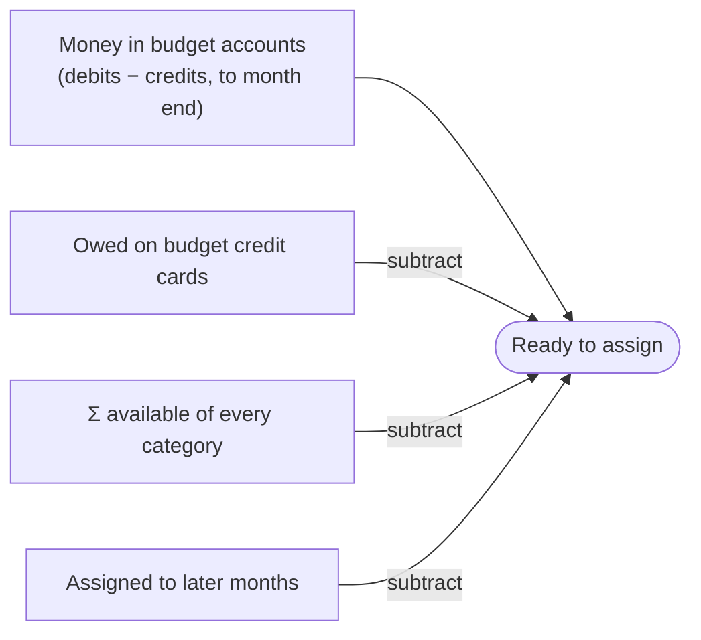

# The budget

finode uses **envelope budgeting** (the YNAB idea): every unit of money in your budget accounts gets a job. The budget sits **on top of the ledger without changing it**.

All of it lives in `app/services/budget.py` (`BudgetService`).

## What is stored, and what is not

Only these things are stored:

| Stored | Where |
|---|---|
| The plan: how much each expense category is *assigned* in each month | `budget_allocations` (user, month = first day, expense account, amount; unique per month and account) |
| Which asset or liability accounts are part of the budget | the flag `accounts.on_budget` |
| Which assets outside the budget are planned for saving (the Save section) | the flag `accounts.saving` |
| Targets (a wish per category: kind, amount, date, weekday) | `budget_targets`, one per category |
| A category's short note | the expense account's `details` column |

Everything else is **derived on demand** from postings and the plan, so editing a transaction can never leave the budget stale.

## The four numbers

For a month and an expense category:

- **Assigned** — what you gave the category this month.
- **Activity** — postings to the category in transactions that touch a budget account. Spending paid from an account outside the budget is ignored (and reported as "left out").
- **Available** — what you can still spend:
  `max(0, last month's available) + assigned − activity`
- **Ready to assign** — money in budget accounts that has no job yet:
  `ready to assign = money in accounts − reserved for cards − Σ available − Σ saving available − assigned to later months`

`BudgetRead` always satisfies that sum, and the page and the `get_budget` tool show it.

### Rolling month to month

`BudgetService._roll` carries the figures forward:

- Leftover money **carries into the next month**.
- An **overspent** category (negative at the end of a month) starts the next month at **zero**, and the deficit is taken out of *Ready to assign* from then on. In its own month an overspent category just shows negative and Ready to assign is unchanged. `overspent_last_month` reports what was deducted.
- Budgeting **starts with the first month anything was assigned**. Earlier spending is ignored, because cash is the balance *now* and past spending already left it; counting it would deduct it twice.
- Money assigned to **later months** is subtracted from Ready to assign in every earlier month, so assigning ahead uses up what is ready now, and the same money reads the same from either month.
- **Moving money** between categories (`move`, limited to what is available) never changes Ready to assign.
- A month's **assigned amount may be negative** to take back what an earlier month left in the category (Move money writes the same), but not by more than the category has left. Otherwise the category would show as overspent with nothing spent and Ready to assign would exceed the money there is.

## Save: planning for the money you keep

An asset or liability outside the budget can be switched on for Build (`accounts.saving`, "Plan under Build" on its edit page; a fund to move money into, a loan to pay its principal down; never together with *Part of the budget* or a payment category: switching it on clears the payment category, joining the budget switches it off). It then becomes a **Build line** (`BudgetSaving`, with `debt` and the amount still owed as `balance` for a loan): a plan row (`budget_allocations`, the same table) can be assigned to it in a month, and its *activity* is what was moved into it from the budget's accounts, that is the debits to it in transactions that touch a budget account (the rule loan payments use; withdrawals do not subtract). Its *available* rolls like a category's. In arithmetic it is a Spend line: assigning lowers Ready to assign, moving the money in does the job and changes nothing, so the identity only gained one term, `saving_available`. Spend's `assigned`, `activity` and `available` (and Home's *Left to spend*) never include Save lines (`BudgetRead.saving`, `saving_assigned`, `saving_activity`, `saving_available`). Because a Save account has no payment category, the reports never count the transfer as spending. Targets work on Save lines as on categories. Switching saving off keeps the amounts (they return if it is switched on again); a closed Save account stays listed while it still has plan left. See [Plan: design proposal](../developer/plan-design.md).

## Earn: income you expect

An Income account (any depth, a group's own account included) can have an **expected amount** for a month: a plan row in the same table (`budget_allocations`), never negative, nothing carrying over. `BudgetRead.earning` lists every open income account without sub-accounts (and a group, or a closed account, while something is expected or arrived) with `expected` and `received` (credits minus debits to the account in the month, up to its last day). It is **informational**: it never changes `ready_to_assign`, is not "assigned to later months", and does not start the budget (rows of other accounts than Spend and Save lines are left out of `_compute`'s plan rows). Income accounts have no targets and money cannot be moved to or from them. The web shows it as the Earn chip (when switched on in the Plan's sliders sheet) with the month in one line: `expected − saving assigned − spending assigned = unplanned`.

## Switching the Plan off

`FINODE_PLAN_ENABLED=false` makes `BudgetService._savings` and `_earnings` return nothing, so the budget is the budget-only one again, with the stored Save and Earn data untouched (see [Plan: design proposal](../developer/plan-design.md), "Rolling back").

## Budget accounts, tracking accounts and liabilities

| Kind of account | In the budget? | Effect |
|---|---|---|
| Asset (bank, cash, wallet) flagged `on_budget` | Yes (default for new asset accounts holding a currency) | Its balance is the cash you can assign. |
| Asset **not** flagged | Tracking only | Appears in net worth, not in the budget. |
| Credit card (liability) flagged `on_budget` | Yes, opted in | Purchases count as category spending; the debt is subtracted from cash and shown under **Cards to pay**. |
| Loan or other liability **not** in the budget | Tracking | Can name a **payment category**: debits to it in a transaction touching a budget account count as spending in that category (credits, such as the loan paying out, do not). |

Reports agree: Categories, the breakdown and the overview count the same payment into a loan as spending in its payment category (interest the lender adds touches no budget account, so only the reports, which count every posting to an expense account, show it).

Spending on an unflagged card is not counted in a category; it is reported as `left_out` and the page offers "Add to budget" for that account.

Credit cards need no assigning. The collapsible credit-accounts row on Home shows what is owed at the month's end (`BudgetCard.owed`), with the month's charged and paid; it is the same arithmetic, made visible.

## Groups

Two-level categories (`Food › Groceries`) show **the sum of their children**. A group's own budget (tapping the figure on its page) starts at that sum and may be raised but never lowered below it (`BudgetService.assign_group`); the extra is kept on the group's own account in `budget_allocations`, so a group's total always adds up its own money and its categories'. The page shows no separate row for it.

## Targets

A target is a stored *wish*; everything it implies is computed:

| Kind | Meaning |
|---|---|
| `monthly` | assign `amount` each month |
| `weekly` | `amount` for each chosen weekday that falls in the month (0 = Monday) |
| `refill` | keep `amount` available (needs amount minus what carried in) |
| `by_date` | save the missing money evenly over the months left, all of it once the date's month arrives |
| `yearly` | a `by_date` that repeats every year (only the month of the date matters) |

A budget line reports `target`, `needed` and `underfunded`; `BudgetService.fund(month)` assigns the underfunded amounts in display order until Ready to assign runs out. A `by_date` target whose month has passed and is still short is *overdue*. A category with a weekly target also lists the month week by week (`BudgetLine.weeks`), computed from daily spending. Targets are hidden unless the **Advanced** switch is on; the data is never touched by the switch.

## Setting up a month

`copy_previous` assigns each open category what it got last month, only where nothing is assigned yet. `assign` and `move` refuse a month that ends inside the locked period.

## Where it surfaces

- **Web:** `/plan` (Ready to assign, categories ranked by size, sheets for assigning), a group's page, the target page, `/plan/move`.
- **Home:** one number, *Left to spend*, taken from the same `view()`.
- **API:** `GET /api/budget/`, `PUT /api/budget/categories/{aid}` and targets.
- **MCP:** `get_budget`, `assign_to_category`, `move_budget_money`, `set_budget_target`, `fund_budget_targets`, `copy_budget_from_previous_month`.

Next: [The web UI](web-ui.md).
