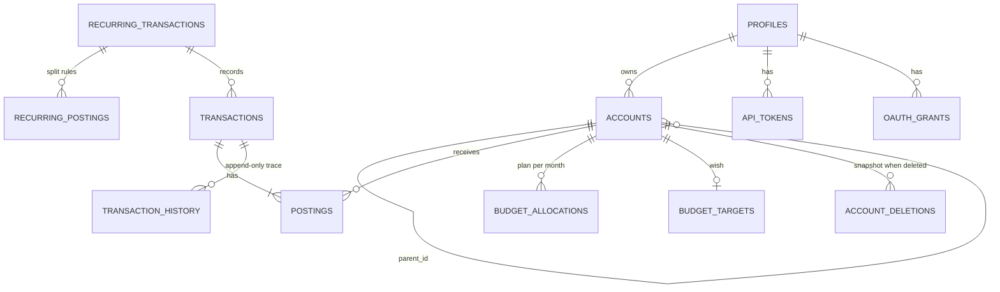
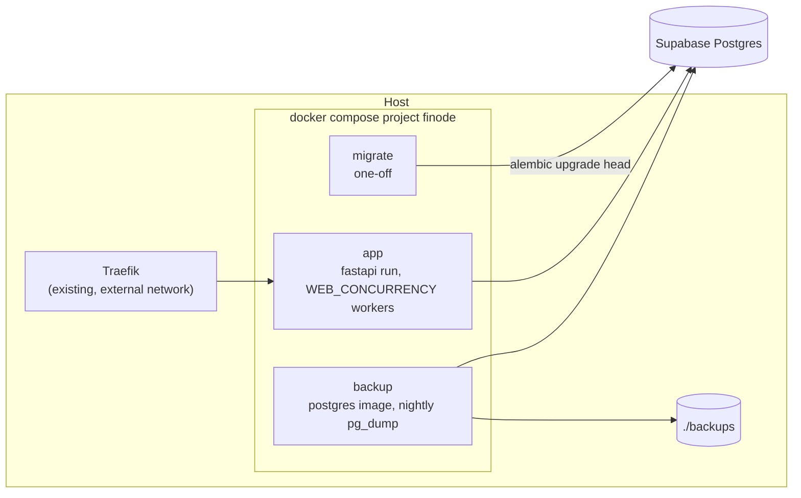

# Data and operations

## The database

Production uses **Supabase Postgres**; tests use an in-memory SQLite database per test (`tests/conftest.py` builds the schema directly and overrides `get_db_session`). Every table that belongs to a person has a `user` column holding the Supabase user id.



| Table | Holds |
|---|---|
| `profiles` | one row per person: names and currency. Per-person settings are typed columns here, not a key-value store. |
| `accounts` | the account tree (parent, `on_budget`, `closed_on`, `payment_category_id`, `position`, note) |
| `transactions`, `postings` | the ledger (see [The ledger](ledger.md)) |
| `transaction_history` | append-only snapshots after every create, update and delete |
| `account_deletions` | append-only snapshots of accounts deleted for good, used by *Recently deleted* |
| `budget_allocations`, `goals`, `goal_allocations` | the plan and the goals (see [The budget](budget.md)) |
| `recurring_transactions`, `recurring_postings` | recurring rules, simple or split |
| `api_tokens`, `oauth_grants` | assistant access (see [MCP and authentication](mcp-and-auth.md)) |

The `users` model in `models/auth.py` only mirrors Supabase's `auth.users` so foreign keys can point at it; Supabase owns that table.

## Migrations

Schema is managed by **Alembic**; the app does not create tables at start-up. The model and the migrations together are the source of truth.

```bash
uv run alembic upgrade head                                   # apply
uv run alembic revision --autogenerate -m "describe the change"   # create (always review the file)
```

A few migrations refuse to run, changing nothing, when the data would not fit (for example the two-levels and single-currency migrations); one cannot be undone (single currency), so you restore a backup instead. In production the `migrate` compose service runs `alembic upgrade head` and the app starts only after it completes. **Take a backup before a migration.**

## Configuration

`app/config.py` exposes `settings` (pydantic-settings), reading `FINODE_*` environment variables and an optional `.env`. Keys without the `FINODE_` prefix are ignored, so one `.env` serves both the app and docker compose. New configuration goes in `config.py`, not into constants.

Main groups: database (`database_url`, `database_echo`), Supabase (`supabase_url`, `supabase_audience`, `supabase_anon_key`, `supabase_service_role_key`), sign-up (`signup_code`, `max_users`), cookies (`cookie_secure`), assistants (`mcp_rate_limit`), recurring (`recurring_interval_minutes`), the clock (`timezone`), per-person limits (`max_*`), and `api_docs`. The README lists the common ones with defaults.

## Import, export, backup, restore

| | Format | Rules |
|---|---|---|
| **Export** | plain-text ledger journal (`/export`, `/api/export`) or CSV | always allowed |
| **Import** | the same journal format (`app/ledger/` parses it, `services/data.py` maps it to accounts and transactions) | only while you have no transactions; preview first; all-or-nothing; unsupported input (conversions, prices, include, …) is an error with its line number |
| **Backup** | one JSON file, `finode-backup` version 2 (`services/backup.py`) | everything you recorded: settings, accounts, transactions, recurring rules, budget plan and goals. Access tokens, connected apps and the audit history are deliberately left out |
| **Restore** | that file | only into an empty ledger; validated first; all-or-nothing; everything gets new ids |

When you add a model or an account/budget flag, add it to the backup and to `tests/test_backup.py`, or it will silently be missing from backups.

## Deployment



- `docker compose up -d --build` builds the image, runs `migrate`, then starts `app` behind Traefik and `backup`.
- The **Dockerfile** is multi-stage: `uv` resolves `uv.lock` into `/opt/venv`; the runtime stage copies only that venv plus `app/`, `migrations/`, `alembic.ini` and `pyproject.toml` (needed for the entrypoint). If a new top-level file is needed at runtime, add it to the `COPY` lines.
- The app publishes **no ports**; only Traefik reaches it, so `FORWARDED_ALLOW_IPS` trusts its `X-Forwarded-*` headers. Rate limiting depends on the real client address coming from those headers, so keep it.
- **Nightly backup:** `scripts/db-backup.sh` dumps the `public` schema, gzips it, verifies it (gzip test and the ledger tables present) before it replaces a `.partial` file, and removes files older than `BACKUP_KEEP_DAYS` (14). Take one on demand with `docker compose run --rm -e BACKUP_ONCE=1 backup`. Logins live in Supabase Auth, not in the dump. The copy off the machine is not automated yet.
- **Deploy checklist:** container healthy; no tracebacks in `docker compose logs app --since 3m`; `/login` answers 200 (the proxy can briefly answer 404 right after a restart).

## Background work

`app/recurring_runner.py` runs in every worker (`FINODE_RECURRING_INTERVAL_MINUTES`, 0 turns it off). Due recurring occurrences are also recorded when someone opens Home, Transactions or Recurring. A unique index makes each occurrence record once however many workers race.

## Limits and rate limiting

Per person, `settings.max_*` (0 = no limit) bound accounts, transactions in total, new transactions a day, postings per transaction and the restore upload size. `limits.ensure_room` raises `LimitReached`; any new way of creating accounts or transactions must go through a service or call it. Sign-in and sign-up attempts are slowed per address, and the MCP endpoint per token.

## Erasing and leaving

Profile › Your data offers **Erase my books** and **Delete my account**. `services/erase.py` walks *every table that has a `user` column*, children first, so a new table is erased without anyone remembering it. Erasing the books keeps `profiles`, `api_tokens` and `oauth_grants`.
