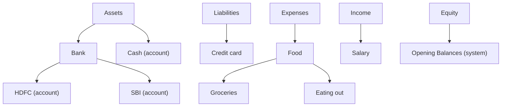
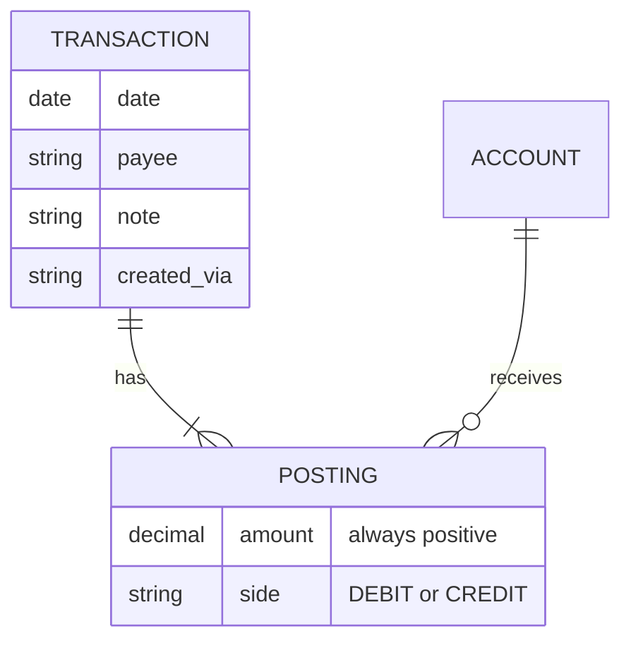

# The ledger

finode is a **double-entry** bookkeeping system. Every amount that moves is recorded as a transaction made of postings, and a transaction only exists if its debits equal its credits.

## Accounts are a tree

Each person has five system **root accounts**: `Assets`, `Liabilities`, `Equity`, `Income`, `Expenses`. They are created on first use (`AccountService._ensure_roots`) and cannot be renamed, moved or deleted. Every other account has a `parent_id`, so the type of an account is simply its root ancestor; nothing else stores a type.

In the web app, **Assets, Liabilities and Equity** are shown as *Accounts* and **Expenses and Income** as *Categories*. This is presentation only; a category is an Expenses or Income account everywhere else (database, API, backup, MCP).

Rules enforced by `AccountService`:

- **Two levels.** Accounts go at most two levels below a root (`MAX_ACCOUNT_DEPTH = 2`): `Expenses › Food › Groceries` is the deepest there is.
- **Names** are trimmed, visible, on one line, at most 40 characters and cannot contain `:` (it is the path separator, as in `Assets:Bank:HDFC`). They are **unique among their siblings, capitals aside** (`_check_name_free`), because the paths name accounts in journal files and for assistants. A journal import is case-sensitive, like the format, and may create `Food` and `food` side by side.
- **Dates** a person can enter lie between 1 Jan 1900 and 31 Dec 2999 (`clock.FIRST_DAY`, `LAST_DAY`, the `Day` type). Past the ends the month arithmetic could fail, so the edges are refused with a message rather than allowed to break pages.
- **Text** never holds a NUL character (Postgres cannot store it); it is dropped on every write.
- **No posting to a root.** Postings may not target a root account.
- **Groups.** An Assets or Liabilities account that has sub-accounts cannot be posted to, and cannot gain sub-accounts once it has postings. Income and Expenses groups *can* be posted to (`GROUP_POSTING_ROOT_NAMES`); the budget shows that money as "Everything else".
- **No reclassifying.** An account cannot move under a different root, because that would silently change what its history means.
- **Opening Balances** is a system account under Equity. Opening balances and direct balance edits are posted against it. It cannot be renamed, moved, deleted or given a balance directly.
- **Closing.** A closed account keeps its history but cannot be posted to. Closing is refused while it holds a balance or a running recurring rule uses it. For a category the word is *Delete*: an unused one is removed for good, one with history is closed instead.

## Transactions and postings

A **posting** is an amount on one account, on the debit or credit side. Amounts are always positive; the side says the direction. A transaction needs at least two postings and **total debits must equal total credits**.

Which side raises a balance:

| Account type | Increases with |
|---|---|
| Assets, Expenses | debit |
| Liabilities, Equity, Income | credit |

An account cannot be on both sides of one entry (money cannot move from an account to itself); the same account on several rows of one side is an ordinary split.

So buying groceries with cash is: debit `Expenses:Food:Groceries`, credit `Assets:Cash`, same amount.

`TransactionService._resolve` is where the invariants live: it checks that postings balance, that every account belongs to the person, that none is closed, deleted or a forbidden target, the decimal places the currency allows, and the per-person limits. The web form, the API, imports, recurring rules and the assistants all create transactions through this one service.

## Balances are derived

No balance is stored. An account's balance is computed from its postings (`AccountService._postings_by_account`, one query for every posting), counting entries dated **up to `as_of`**, which is today by default. Entries dated in the future therefore do not count yet, but the account's register still lists them (as "upcoming").

## Integrity safeguards

- **Database checks.** `postings` has `CHECK` constraints (`amount > 0`, `side IN ('DEBIT','CREDIT')`). Balance and "at least two postings" cannot be a plain check, so they are enforced in the service and re-verified by `ReportService.trial_balance` (the `check_books` tool in MCP), which re-reads every stored transaction and names any that fail.
- **Stable posting ids.** Editing a transaction updates postings in place where it can, so anything pointing at a posting keeps working.
- **Append-only history.** `transaction_history` gets a row on every create, update and delete, holding the transaction as it stood afterwards. It has no foreign key, so a deleted transaction's trace survives. The edit page does not show it; **Recently deleted** reads it to restore an entry (with its old id). Account deletions have a similar log (`account_deletions`). `TransactionService.changes(tid)` and `recent_changes(since, via, limit)` turn those snapshots into steps with a diff against the step before (`_diff`: date, payee, note, reference and rows added, removed or changed; an unchanged save adds no step); they back `GET /api/transactions/{tid}/changes`, `GET /api/transactions/changes` and the MCP tools `get_transaction_history` and `recent_changes`.
- **Account history.** `account_history` (migration `e5a7c9b1d3f4`) is the same idea for accounts and categories: a row for every creation, change, closing, reopening, restoring and deletion, with who did it (`AccountRepository.origin`: `web`, `api` or `mcp:<name>`) and the account as it stood afterwards (name, path, note, budget flag, payment category, closing day). It has no foreign key, so a deleted account's trace survives it, and finode's own roots, built-in groups and Opening Balances account are not logged. Changes made before it existed have no history. `AccountService.changes` / `recent_changes` diff consecutive rows for `GET /api/accounts/{aid}/changes`, `GET /api/accounts/changes` and the assistants' `get_account_history` and `recent_changes(what='accounts')`. It is erased with the books like every table with a `user` column and is not in the backup.
- **Related entries.** `transactions.related_id` points at an earlier entry of the same person (a refund, a reversal, a cash-back…). It is only a link: nothing in the ledger, budget or reports reads it. The service refuses an id that is not the person's own, an entry related to itself and a circle; deleting the original clears the link; a backup carries it and a restore maps it to the new ids. The history snapshot carries `related_id`, and a deletion's snapshot also lists the entries that pointed at it (`related_from`), so restoring the entry links both ways again (`TransactionService._restorable_link`, `_relink`): the earlier entry must still exist, and an entry that has another link by now, or whose link would make a circle, is left alone.
- **References from outside.** `transactions.source` (a short kind such as `gmail` or `upi`, lower-cased), `external_id` (the reference that source gave the entry; it needs a source) and `source_url` (an http(s) link back) say where an entry came from. A partial unique index on `(user, source, external_id)` makes a source's reference belong to one entry; `TransactionService.create_once` answers a repeat with the entry already there when the date and rows are the same (the JSON API says 200 instead of 201, MCP says `already_recorded`) and refuses the same reference with different content. Changing an entry cannot take another entry's reference, deleting an entry frees its reference, and restoring a deleted entry gets it back unless it has been used since. The history snapshot, the backup (a file that repeats a pair is refused) and the details sheet carry them; nothing in balances, the budget or reports reads them.
- **Tags.** `tags` (`tgid`, `user`, `name` lower case up to 30 characters, unique per person) and `transaction_tags` (entry, tag, user; migration `a2c4e6f8b1d3`) make a tag its own thing on an entry; the note is plain words (before 2026-10-26 a tag was a `#word` in the note, `app/tags.py`, nothing stored). `app/tags.py` cleans names (`clean_name`: no `#`, lower case, letters, digits, `-`, `_`, at least one letter) and keeps `tags_in`, `without_tags` and `split_note` only to move the `#words` of older notes and backups into tags. An entry has up to 10 tags (`MAX_TAGS_PER_ENTRY`) and a person up to `FINODE_MAX_TAGS` (200). **A tag exists only while an entry carries it** (`TransactionRepository.set_tags` removes unused ones). `TransactionCreate.tags` / `TransactionUpdate.tags` (`None` keeps, `[]` clears) / `TransactionRead.tags`; lists load the tags of all rows with one query (`tag_map`); `list(tag=)` is a join. The history snapshot carries `tags`, so restoring an entry brings them back. Rename (into an existing tag it merges), merge and delete are `TransactionService.rename_tag` / `merge_tags` / `delete_tag`; they do not write the entries' history. The backup (version 3) carries each entry's `tags`; a file before version 3 has its notes' `#words` moved into tags on restore. The ledger export writes a `; tags: a, b` comment and the import reads it back; the CSV has a `tags` column.
- **Recurring entries are recorded once.** A unique index on `(recurring_id, recurring_date)` makes repeated or concurrent runs safe.

Any new code that writes transactions outside `TransactionService` must call the lock check itself, and any new write path should keep a test asserting `trial_balance().balanced`.

## Loans, cards and the budget flag

A **credit card** or **loan** is a Liability. An asset or liability can be flagged `on_budget`; the [budget](budget.md) works on those accounts. A liability outside the budget can name a *payment category*, so paying an EMI counts as spending in that category.

Next: [The budget](budget.md).
