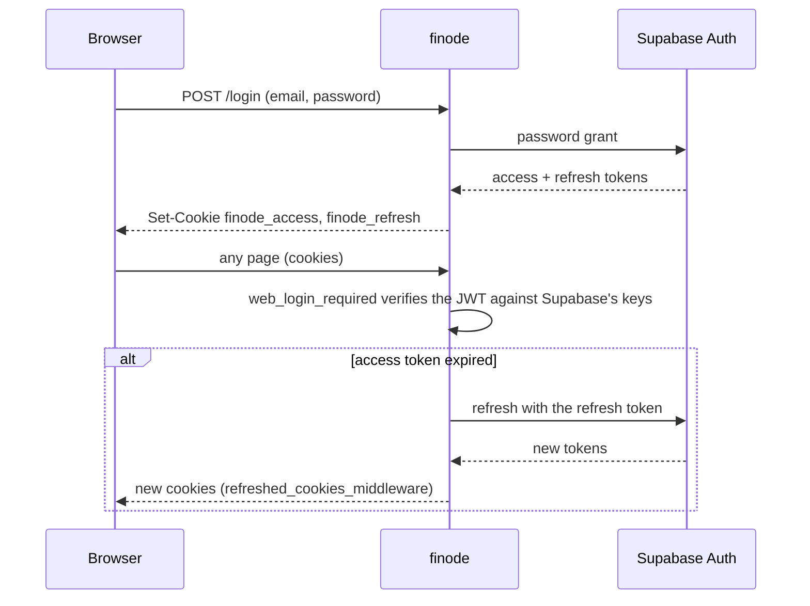
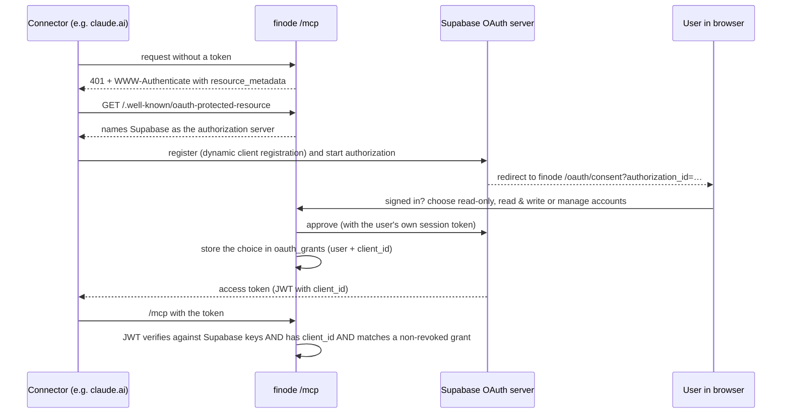

# MCP server and authentication

finode has four ways to prove who you are, and each one reaches only the door it is meant for.

| Credential | Used on | Issued by |
|---|---|---|
| Login **cookies** (`finode_access`, `finode_refresh`) | the web app | finode, after a Supabase password sign-in |
| A Supabase **bearer token** | the JSON API | Supabase |
| A **personal access token** (`fin_…`) | `/mcp` only | finode, on `/profile/assistants` |
| An **OAuth access token** for a connected app | `/mcp` only | Supabase's OAuth server |

Identity itself is **Supabase Auth**; finode stores no passwords. The ledger data lives in the same Supabase Postgres.

## The web login

`app/web_auth.py` signs people in through Supabase's password grant and keeps the tokens in `HttpOnly` cookies (path `/`; `Secure` when `FINODE_COOKIE_SECURE` is true).

`web_login_required` stores the verified token in `request.state`, which `require_authenticated_user` accepts in addition to a bearer header, so the repositories stay scoped to the user. **The JSON API never reads cookies.**

Sign-up is invite-only (`app/signup.py`): the invite code is compared in constant time and users are created, already confirmed, through Supabase's admin API with the **service key**. That key must stay server-side: never render it, log it or send it to a browser. Password reset (`app/reset.py`, `/forgot`, `/reset`) is off unless `FINODE_PASSWORD_RESET=true`. Sign-in and sign-up attempts are slowed per address by the in-memory limiter in `app/ratelimit.py`.

## The MCP server

`app/mcp_server/` serves an MCP server at `/mcp` (Streamable HTTP) built on the official `mcp` SDK. It is **stateless with JSON responses**, so any worker can answer any request. It is a plain ASGI route added in `app/main.py`; `lifespan` starts the SDK's session managers.

| Module | Job |
|---|---|
| `transport.py` | `MCPEndpoint`: check the bearer token, rate-limit it, pick the server for its scope, serve the protected-resource metadata |
| `context.py` | `services()`: build the services for the token's user, the way `dependencies.py` does for a web request |
| `tools.py` | the tools, the instructions text, the prompt |
| `accounts.py` | `AccountIndex.find`: turn `Assets:Bank:HDFC`, or a unique end like `HDFC`, into an account and explain ambiguous or unknown names |

### Tools

Eighteen read tools: `list_categories` (the categories with ids, paths and kind: spending ones are what the budget plans against, earning ones label income; `category` on `record_transaction`, `record_transactions` and `create_recurring`, and on a `record_split` row, takes a path such as `EMI` or `Food:Groceries`, and a row may name only a category instead of an account; `spending_breakdown` takes `by=category|account`),  `get_account_history` (what happened to one account, renames, moves, closings, with who did it; a deleted account by its id), `list_tags` (the tags in use with their counts; tags are their own tables since 2026-10-26, see the ledger page; `search_transactions` takes `tag` and every transaction reads back `tags`), `check_balance` (a statement's balance against the books on the same day: whether they agree, the difference and the recent entries, marking those exactly as large as the difference; nothing is changed), `payee_defaults` (how the user usually books a payee: the newest simple entry's accounts, its kind, the use count and other routes; `TransactionService.payee_routes` is the one place that works this out, shared with the Add screen's payee chips), `get_transaction_history` (one entry's steps, oldest first, each edit with exactly what changed and who did it, deleted entries too), `recent_changes` (the latest steps across all entries, or with `what='accounts'` across all accounts, by day and by origin, `by='assistant'` for what assistants did), `get_status` (access level, currency, today, size and last change of the books, room left today), `get_overview`, `list_accounts`, `get_account`, `search_transactions`, `get_transaction`, `spending_breakdown`, `list_recurring`, `check_books`, `get_budget`, `list_deleted_transactions`. Accounts, postings and budget lines carry their ids (an id survives a rename, a path does not); `list_accounts` also gives type, `on_budget`, payment category, built-in group and details; `search_transactions` filters by payee and kind, pages with `offset`, and answers `count`, `spent`, `earned`, `transferred` (and `account_net_change`) over every match.

Eleven tools usable only at the `manage` level (`update_category`, `close_category`, `reopen_category` and `merge_categories` join the tag and account tools below; `create_category` is a write tool) (`MANAGE_TOOLS`; they are listed at every level but refuse below it): `rename_tag`, `merge_tags` and `delete_tag` (`TransactionService.rename_tag` / `merge_tags` / `delete_tag`; renaming into an existing tag is a merge, deleting takes the tag off its entries and keeps them) and four account tools: `update_account` (rename, note, move, budget flag, payment category; the id never changes, only the path), `close_account`, `reopen_account` and `merge_accounts` (`AccountService.merge`: one plain account becomes part of another, see below; `dry_run` works at every level). They call the same `AccountService` methods as the web app, so every rule applies (two levels, one root, unique names, the built-in groups untouched), and they never delete an account except by merging one away.

**Merging** (`AccountService.merge`, `POST /api/accounts/{aid}/merge`): the source (a plain account with no sub-accounts) is folded into a target of the same top-level account that is open and can take postings. Its postings move (each entry gets an `updated` history row naming who did it), its planned amounts are added to the target's by month, recurring rules and payment links are re-pointed, and the source is deleted (it shows under Recently deleted, but restoring brings back only an empty account). It is one database transaction, and it is refused when an entry or rule has both accounts on opposite sides, when only one is part of the budget, or for built-in groups, roots and Opening Balances. The account history records `merged_from` on the target and `merged_into` on the source.

Nineteen write tools: `record_transaction`, `record_split`, `record_transactions` (up to 50 entries as one: `TransactionService.record_batch` checks every entry first and names each one at fault, then saves all in one database transaction or none; entries whose source and reference are already recorded are skipped, so a batch can be sent again; the limits are checked for the whole batch; `dry_run` shows it first), `update_transaction`, `delete_transaction` (marked destructive), `create_account`, `create_recurring`, `stop_recurring`, `resume_recurring`, `skip_recurring_occurrence`, `restore_transaction`, `create_goal`, `update_goal`, `delete_goal` (marked destructive), `assign_to_category`, `assign_to_goal`, `use_goal`, `move_budget_money`, `copy_budget_from_previous_month`. `record_transaction`, `record_split`, `record_transactions` and `update_transaction` take `tags` (a list of names; `update_transaction` also `add_tags` and `remove_tags`, and a `#word` in a note gets a `notice` instead of being read), and `record_transaction`, `record_split` and `update_transaction` take `related_to` (an earlier transaction's id; an empty string removes the link on update) and `source`, `external_id` and `source_url` (where the entry came from; recording the same source and reference again returns the existing entry with `already_recorded: true`, the same reference with different content is an error; an empty string clears them on update). `search_transactions` filters by `source` and `external_id`. The five tools that record, change or delete transactions take `dry_run` (`TransactionService.preview_create` / `preview_update` / `preview_delete`, which share their checks with the real calls through `_check_new` and `_check_update`); `tools._refused` lets a dry run through on a read-only connection and refuses every other call.

One prompt, `monthly_review`. Assistants can create accounts but never delete or edit them. Amounts go out as strings. A service error becomes a `ToolError` with the service's message. `INSTRUCTIONS` in `tools.py` must be kept in step with the ledger rules.

There are **three access levels** (`TokenScope`: `read`, `write`, `manage`; `manage` is write plus changing accounts, migration `d3f5b7c9e1a2`, and nobody has it until they choose it). Each level gets its own server (`SERVERS`, `build_server(access)`) with instructions that say what it may do. A tool a connection may not use is still listed but only refuses, telling the assistant which level the user must allow under Profile › AI assistants: the write tools refuse on a **read-only** connection (except `dry_run=true`), the account-changing tools (`MANAGE_TOOLS`) refuse on anything below `manage`.

### Origin

Transactions record who made them (`created_via` / `updated_via`: `web`, `api`, `import`, `recurring`, `mcp:<token name>`). The list marks entries made or changed by an assistant, and the edit page says who added and last changed it.

## Phase 1: personal access tokens

Users create and revoke tokens on `/profile/assistants`, choosing read-only, read & write or read, write & manage accounts. Only a sha256 of the `fin_…` secret is kept, plus a display prefix; the secret is shown once. A token works **only on `/mcp`**, never on the JSON API, and cannot manage tokens. There is a per-token, per-process rate limit (`FINODE_MCP_RATE_LIMIT` a minute).

## Phase 2: OAuth for claude.ai and other connectors

Supabase's OAuth 2.1 server registers the apps, runs the sign-in and issues their tokens; **finode never issues tokens**.

Details that matter:

- The scope (read or write) is stored by finode in `oauth_grants`, because Supabase has no read/write scope.
- An ordinary sign-in token has no `client_id` and is **refused on `/mcp`**; conversely an app's token is refused by the JSON API and the web UI (`auth.reject_app_token`), so it can never act as a full sign-in.
- Disconnecting an app (Profile › AI assistants › Connected apps) revokes the grant and asks Supabase to revoke the app's tokens.
- The consent page is reached through `/oauth/consent`; the login page only honours a `next` that points there (`web_auth.safe_next`).

## Isolation

Every query is filtered by the user. `tests/test_isolation.py` proves it: it gives person A a ledger that uses every feature, then person B tries every route, list, form field and assistant token to reach it. A new route cannot ship without being classified there.

Next: [Data and operations](data-and-ops.md).
