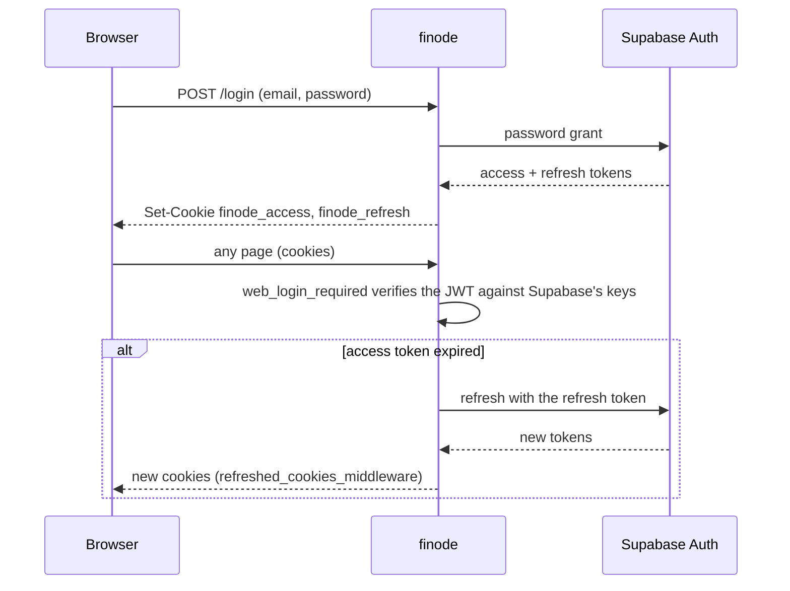

# MCP server and authentication

finode has four ways to prove who you are, and each one reaches only the door it is meant for.

| Credential | Used on | Issued by |
|---|---|---|
| Login **cookies** (`finode_access`, `finode_refresh`) | the web app | finode, after a Supabase password sign-in |
| A Supabase **bearer token** | the JSON API | Supabase |
| A **personal access token** (`fin_…`) | `/mcp` only | finode, on `/profile/assistants` |
| An **OAuth access token** for a connected app | `/mcp` only | Supabase's OAuth server |

Identity itself is **Supabase Auth**; finode stores no passwords. The ledger data lives in the same Supabase Postgres.

## The web login

`app/web_auth.py` signs people in through Supabase's password grant and keeps the tokens in `HttpOnly` cookies (path `/`; `Secure` when `FINODE_COOKIE_SECURE` is true).

`web_login_required` stores the verified token in `request.state`, which `require_authenticated_user` accepts in addition to a bearer header, so the repositories stay scoped to the user. **The JSON API never reads cookies.**

Sign-up is invite-only (`app/signup.py`): the invite code is compared in constant time and users are created, already confirmed, through Supabase's admin API with the **service key**. That key must stay server-side: never render it, log it or send it to a browser. Password reset (`app/reset.py`, `/forgot`, `/reset`) is off unless `FINODE_PASSWORD_RESET=true`. Sign-in and sign-up attempts are slowed per address by the in-memory limiter in `app/ratelimit.py`.

## The MCP server

`app/mcp_server/` serves an MCP server at `/mcp` (Streamable HTTP) built on the official `mcp` SDK. It is **stateless with JSON responses**, so any worker can answer any request. It is a plain ASGI route added in `app/main.py`; `lifespan` starts the SDK's session managers.

| Module | Job |
|---|---|
| `transport.py` | `MCPEndpoint`: check the bearer token, rate-limit it, pick the server for its scope, serve the protected-resource metadata |
| `context.py` | `services()`: build the services for the token's user, the way `dependencies.py` does for a web request |
| `tools.py` | the tools, the instructions text, the prompt |
| `accounts.py` | `AccountIndex.find`: turn `Assets:Bank:HDFC`, or a unique end like `HDFC`, into an account and explain ambiguous or unknown names |

### Tools

Nine read tools: `get_overview`, `list_accounts`, `get_account`, `search_transactions`, `get_transaction`, `spending_breakdown`, `list_recurring`, `check_books`, `get_budget`.

Thirteen write tools: `record_transaction`, `record_split`, `update_transaction`, `delete_transaction` (marked destructive), `create_account`, `create_recurring`, `stop_recurring`, `skip_recurring_occurrence`, `assign_to_category`, `move_budget_money`, `copy_budget_from_previous_month`, `set_budget_target`, `fund_budget_targets`.

One prompt, `monthly_review`. Assistants can create accounts but never delete or edit them. Amounts go out as strings. A service error becomes a `ToolError` with the service's message. `INSTRUCTIONS` in `tools.py` must be kept in step with the ledger rules.

A **read-only** connection gets a server in which the write tools are still listed but only refuse, telling the assistant to ask the user to allow read & write under Profile › AI assistants.

### Origin

Transactions record who made them (`created_via` / `updated_via`: `web`, `api`, `import`, `recurring`, `mcp:<token name>`). The list marks entries made or changed by an assistant, and the edit page says who added and last changed it.

## Phase 1: personal access tokens

Users create and revoke tokens on `/profile/assistants`, choosing read-only or read & write. Only a sha256 of the `fin_…` secret is kept, plus a display prefix; the secret is shown once. A token works **only on `/mcp`**, never on the JSON API, and cannot manage tokens. There is a per-token, per-process rate limit (`FINODE_MCP_RATE_LIMIT` a minute).

## Phase 2: OAuth for claude.ai and other connectors

Supabase's OAuth 2.1 server registers the apps, runs the sign-in and issues their tokens; **finode never issues tokens**.

Details that matter:

- The scope (read or write) is stored by finode in `oauth_grants`, because Supabase has no read/write scope.
- An ordinary sign-in token has no `client_id` and is **refused on `/mcp`**; conversely an app's token is refused by the JSON API and the web UI (`auth.reject_app_token`), so it can never act as a full sign-in.
- Disconnecting an app (Profile › AI assistants › Connected apps) revokes the grant and asks Supabase to revoke the app's tokens.
- The consent page is reached through `/oauth/consent`; the login page only honours a `next` that points there (`web_auth.safe_next`).

## Isolation

Every query is filtered by the user. `tests/test_isolation.py` proves it: it gives person A a ledger that uses every feature, then person B tries every route, list, form field and assistant token to reach it. A new route cannot ship without being classified there.

Next: [Data and operations](data-and-ops.md).
