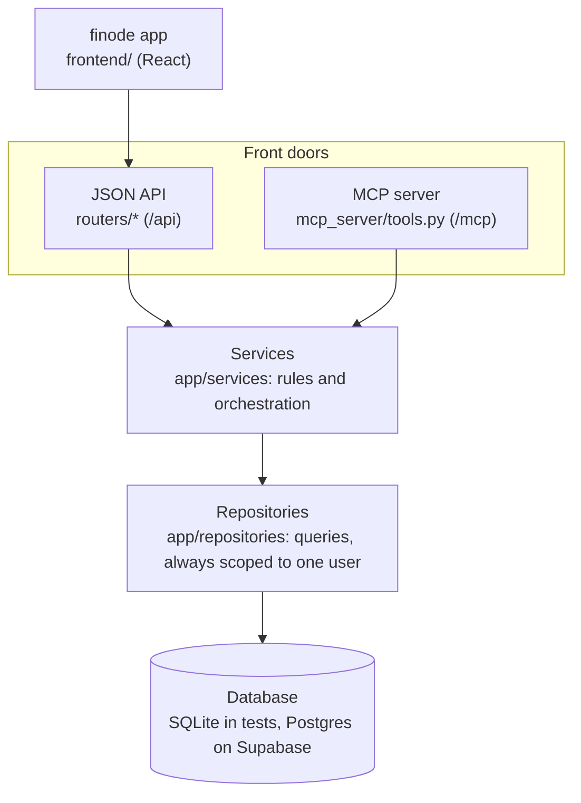
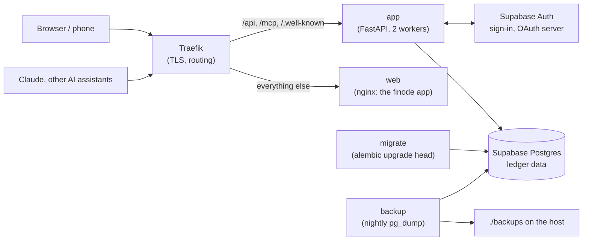

# Architecture overview

finode is one FastAPI application with two front doors over the same business code, and one UI on top:

- the **JSON API** under `/api`, which **the finode app** (React, in `frontend/`) uses for everything, and scripts too;
- the **MCP server** at `/mcp`, for AI assistants.

Both call the same services, so a rule such as "a transaction must balance" exists once. The app is static files on the same address: Traefik sends the API's paths to the FastAPI container and everything else to the app's.

## The layers



| Layer | Folder | Job | Must not |
|---|---|---|---|
| Front doors | `routers/`, `mcp_server/` | Turn a request into a service call and the answer into JSON or a tool result. Turn "not found" into a 404. | Touch the database, or repeat a ledger rule. |
| Services | `services/` | The rules: balancing a transaction, deriving balances, the budget arithmetic, recurring rules, backup. | Know about HTTP. |
| Repositories | `repositories/` | Persistence. Every query is filtered by the signed-in user (`self.uid`). | Hold business rules. |
| Models | `models/` | SQLModel tables, the source of truth for the schema together with the Alembic migrations. | |
| Schemas | `schemas/` | Pydantic request and response shapes (`*Base`, `*Create`, `*Read`, `*Update`). | |

Two layers sit beside the main stack:

- `ledger/` reads and writes the plain-text ledger journal format (used by import and export). It has no dependency on the rest.
- `frontend/` is the app: it reads one view per screen (`/api/views/…`, built by `services/*_view.py`) and saves through the API. See [The app](web-ui.md).

## How a request travels

```mermaid
sequenceDiagram
    participant B as Browser
    participant T as Traefik (TLS)
    participant F as FastAPI
    participant D as dependencies.py
    participant S as Service
    participant R as Repository
    participant DB as Database
    B->>T: POST /api/entries (cookie, X-Finode: 1)
    T->>F: forwarded request (X-Forwarded-* headers)
    F->>D: require_authenticated_user reads the cookie
    D->>D: verify the token (refresh it if expired); a change must come from the app's own address
    D->>S: build services for this user (session + user id)
    F->>S: EntryService.create(...)
    S->>S: validate: balanced, accounts are the user's, limits
    S->>R: write transaction and postings
    R->>DB: INSERT (all in one database transaction)
    S-->>F: result
    F-->>B: 201 with what was recorded; the app refreshes its views
```

`app/dependencies.py` is the place where a request becomes "this user": it opens a database session, resolves the user from the cookie or bearer token, and constructs repositories and services bound to that user id. Handlers receive ready-made services (`Budget`, `Reports`, `DBSession`, …) as typed parameters.

## Start-up and background work

`app/main.py` wires everything:

- mounts the JSON routers under `/api` and `/mcp` as a plain ASGI route (every other path is the app's, served by its own container);
- registers small middlewares: sending a refreshed login cookie, refusing to be framed, and compressing answers;
- runs two things in the `lifespan`: the MCP session managers and `recurring_runner`, a background loop that records due recurring transactions every `FINODE_RECURRING_INTERVAL_MINUTES` (default 15) in every worker.

The application does **not** create tables at start-up. Schema changes are Alembic migrations, applied by the `migrate` container before the app starts.

## The pieces around the app



See [Data and operations](data-and-ops.md) for deployment details and [MCP and authentication](mcp-and-auth.md) for the sign-in flows.

## Cross-cutting rules worth knowing

- **Isolation.** Every table carries a `user_id` column and every query filters on it. `tests/test_isolation.py` is the guard: it classifies every route and tries to reach person A's data as person B.
- **One currency per person.** Stored amounts are plain numbers; the currency (`profiles.currency`) only decides how they are labelled and how many decimals are allowed.
- **Derived, not stored.** Balances, the budget's available amounts and Ready to assign are computed from postings and the plan on demand, so editing the ledger cannot leave them stale.
- **Today.** Code asks `clock.local_today()`, never `date.today()`, so "today" follows `FINODE_TIMEZONE`.
- **Queries per screen.** Each query is a ~15 ms round trip to the hosted database, so a view must not query once per row, and what several services ask for repeatedly (accounts, postings, the profile, the budget plan) is loaded once per request by the session's read memory (`repositories/cache.py`; it forgets on every write). `tests/test_query_counts.py` fails when the statement count grows with the data or a view exceeds its ceiling.
- **Compression.** The API's JSON is gzip-compressed (`GZipMiddleware`); the app's files are compressed by nginx.

Next: [The ledger](ledger.md).
