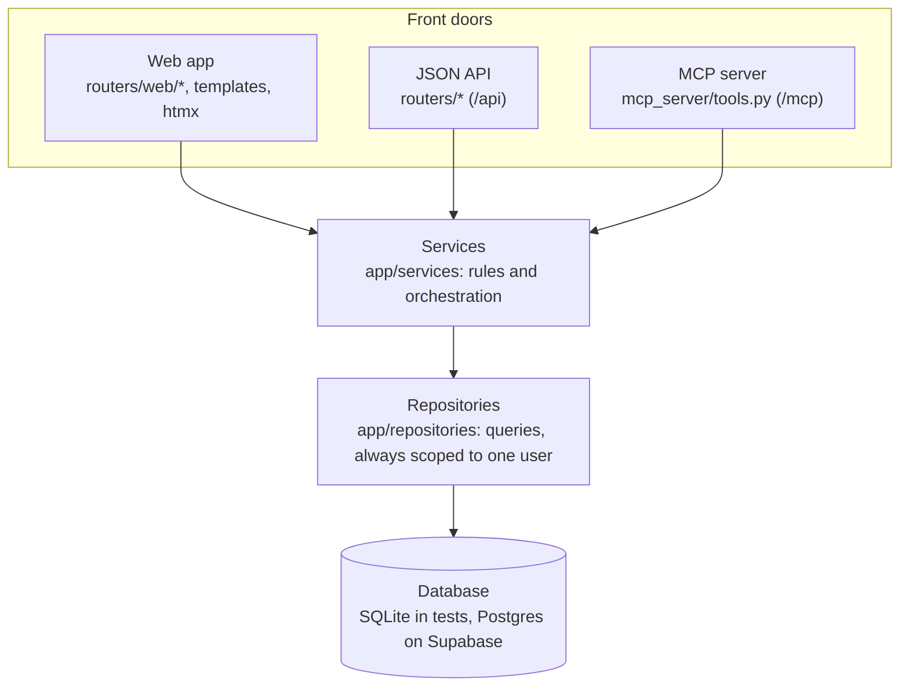
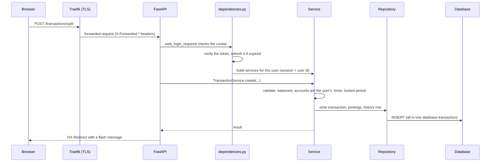
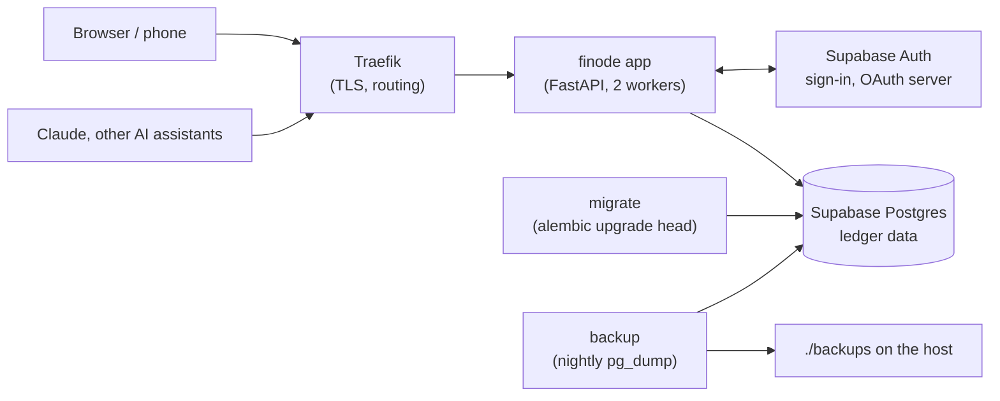

# Architecture overview

finode is one FastAPI application that serves three front doors over the same business code:

- the **web app** at the site root (server-rendered HTML, enhanced with htmx),
- the **JSON API** under `/api`,
- the **MCP server** at `/mcp`, for AI assistants.

All three call the same services, so a rule such as "a transaction must balance" exists once.

## The layers

| Layer | Folder | Job | Must not |
|---|---|---|---|
| Front doors | `routers/`, `routers/web/`, `mcp_server/` | Turn a request into a service call and the answer into HTML, JSON or a tool result. Turn "not found" into a 404. | Touch the database, or repeat a ledger rule. |
| Services | `services/` | The rules: balancing a transaction, deriving balances, the budget arithmetic, recurring rules, backup. | Know about HTTP. |
| Repositories | `repositories/` | Persistence. Every query is filtered by the signed-in user (`self.uid`). | Hold business rules. |
| Models | `models/` | SQLModel tables, the source of truth for the schema together with the Alembic migrations. | |
| Schemas | `schemas/` | Pydantic request and response shapes (`*Base`, `*Create`, `*Read`, `*Update`). | |

Two layers sit beside the main stack:

- `ledger/` reads and writes the plain-text ledger journal format (used by import and export). It has no dependency on the rest.
- `templates/` and `static/` are the web UI. There is no JavaScript build step.

## How a request travels

`app/dependencies.py` is the place where a request becomes "this user": it opens a database session, resolves the user from the cookie or bearer token, and constructs repositories and services bound to that user id. Handlers receive ready-made services (`Budget`, `Reports`, `DBSession`, …) as typed parameters.

## Start-up and background work

`app/main.py` wires everything:

- mounts the JSON routers under `/api`, the web router at `/`, and `/mcp` as a plain ASGI route;
- registers three small middlewares: refreshing the login cookie, clearing a shown flash message, and cache headers;
- runs two things in the `lifespan`: the MCP session managers and `recurring_runner`, a background loop that records due recurring transactions every `FINODE_RECURRING_INTERVAL_MINUTES` (default 15) in every worker.

The application does **not** create tables at start-up. Schema changes are Alembic migrations, applied by the `migrate` container before the app starts.

## The pieces around the app

See [Data and operations](data-and-ops.md) for deployment details and [MCP and authentication](mcp-and-auth.md) for the sign-in flows.

## Cross-cutting rules worth knowing

- **Isolation.** Every table carries a `user` column and every query filters on it. `tests/test_isolation.py` is the guard: it classifies every route and tries to reach person A's data as person B.
- **One currency per person.** Stored amounts are plain numbers; the currency (`profiles.currency`) only decides how they are labelled and how many decimals are allowed.
- **Derived, not stored.** Balances, the budget's available amounts and Ready to assign are computed from postings and the plan on demand, so editing the ledger cannot leave them stale.
- **Today.** Code asks `clock.local_today()`, never `date.today()`, so "today" follows `FINODE_TIMEZONE`.
- **Queries per page.** A page must not query once per row. `tests/test_query_counts.py` fails when the statement count grows with the data.

Next: [The ledger](ledger.md).
