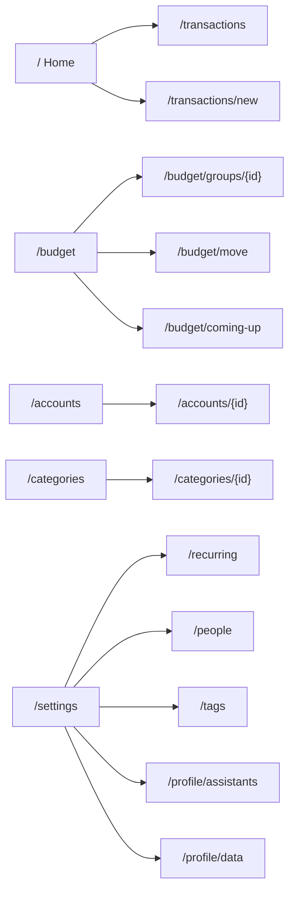

# The app

finode's one UI is **the finode app**: React + TypeScript, built with Vite, in `frontend/`. It is static files served by the `web` container (nginx) on the same address as the API, and it talks to the server only through the JSON API (`/api`). It replaced the server-rendered pages on 2026-11-17 (see [removed.md](../developer/reference/removed.md)); the rules for working on it are the UI section of `AGENTS.md`.

## Where things are

| What | Where |
|---|---|
| Routes, the session, the layout, toasts, the offline banner | `frontend/src/app/` (`router.tsx`, `session.tsx`, `Layout.tsx`, `Offline.tsx`) |
| The API client | `frontend/src/api/` (`schema.d.ts` generated from `openapi.json`; `client.ts`, `useApi()`; `messages.ts`) |
| The shared parts | `frontend/src/components/` (`Row`, `Tile`, `Sheet`, `Chips`, `MonthPill`, `Figure`, `CalcInfo`, `AmountField`, `EmptyState`, `Icon`; `lines/`, the Add screen's rows) |
| One folder per area | `frontend/src/features/` (`home`, `transactions`, `entry`, `accounts`, `categories`, `budget`, `todo`, `people`, `recurring`, `tags`, `settings`, `consent`, `auth`) |
| Writing amounts and days | `frontend/src/lib/` (`money.ts`, `amount.ts`, `dates.ts`, `split.ts`) |
| Colours, the base look, the font | `frontend/src/styles/` (`tokens.css`, `base.css`, `fonts/`) |
| What each screen shows | the server: `app/routers/views.py` (`/api/views/…`) built by `app/services/*_view.py` and `transaction_rows.py` |

## The screens



The bottom tab bar on phones is Home, Budgets, Accounts and Categories with the "+" docked in the middle (nothing floats over the page); from 60rem a fixed sidebar replaces it. Transactions has no tab: it is reached from "View all" on Home and from the sidebar. Each screen is described in [ui-pages.md](../developer/reference/ui-pages.md).

## How a screen gets its data

```mermaid
sequenceDiagram
    participant S as Screen (React)
    participant Q as TanStack Query
    participant A as /api/views/… (FastAPI)
    participant V as services/*_view.py
    S->>Q: useQuery(["views", "home", month])
    Q->>A: GET /api/views/home?month=… (session cookie)
    A->>V: build the screen: rows, totals, words, signs
    V-->>A: one answer
    A-->>Q: JSON
    Q-->>S: render (cached; shown at once next time)
```

1. **A screen reads one view.** `/api/views/…` answers what one screen shows in one call, worked out by the server (`services/transaction_rows.py` and the `*_view.py` modules): what a row is called, its second line, which way the money went, a month's totals. The app does no ledger arithmetic; its only sum on money is what is left to allocate on the Add screen (`lib/split.ts`).
2. **A change goes through the API** (`/api/entries`, `/api/budget/…`, …) with `X-Finode: 1` from the app's own address; on success every cached view (key prefix `["views"]`) is refreshed, so no screen shows stale books.
3. **A refusal** shows the server's own words beside the form, which is never cleared; a lost connection or a server failure says so in plain words (`api/messages.ts`).

## Conventions you will meet

- **Phones first.** Text inputs at 16px or more so iOS does not zoom; our own chips and sheets over native pickers (except the month and date pickers laid over our chips), so iOS and Android look the same.
- **Bento tiles.** Rows sit in soft rounded tiles (`components/Tile`): a tile per day in transaction lists, per group on Budgets, per section in Settings.
- **Tokens only.** Colours come from `tokens.css`; both dark blocks define the same tokens (a test compares them). Green and red are for money in and out only.
- **Amounts are strings** end to end, never `Number`. Typing cleans them (`lib/amount.ts`), writing groups them (lakhs and crores for INR), and the server checks again.
- **Today is the server's** (`useToday()`, in `FINODE_TIMEZONE`), never the device's clock.
- **Offline.** A banner says so; nothing is saved until the connection is back (there is no offline queue).
- **Updates.** The service worker fetches a new version in the background and puts it in once the page is hidden, so an open screen never reloads under someone typing. It leaves every API path to the network.

## Tests for the app

Vitest tests sit beside each component and run in `npm run check`. What needs a real browser is in `tests/browser/` (Playwright): `tests/browser/server.py` serves the built app and the API on one address with an in-memory database, only Supabase stood in for; the fixtures are `page`, `signed_in_page`, `api` and `books`. Run them with `scripts/browser-tests.sh` (`FINODE_BROWSER=webkit` for the closest to iOS Safari).

Next: [The design system](design.md).
