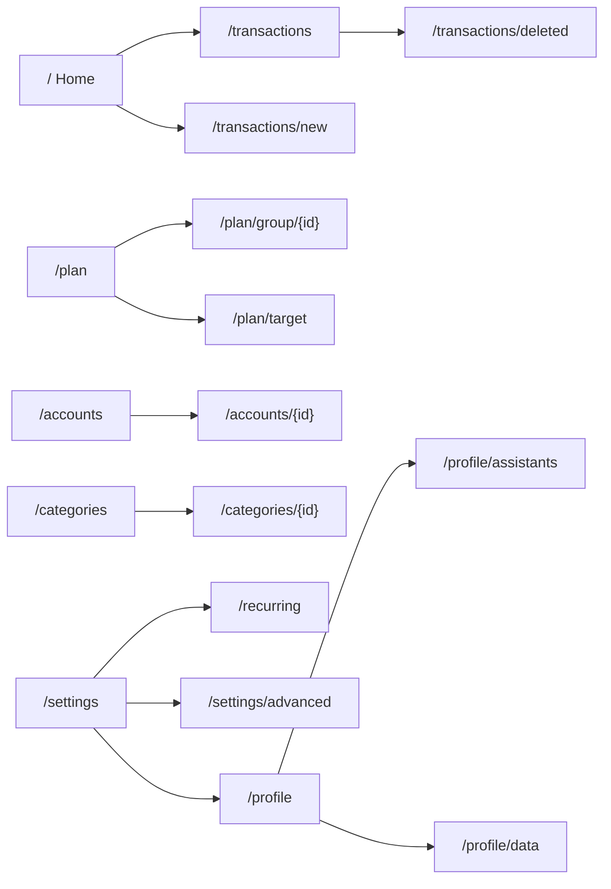

# The web UI

The web app is **server-rendered HTML** (Jinja2) with a little vendored **htmx** and one hand-written script, `app/static/app.js`. There is **no JavaScript build step** and none should be added.

## Where things are

| What | Where |
|---|---|
| Page handlers | `app/routers/web/*.py` (one module per area: `accounts`, `budget`, `categories`, `dashboard`, `transactions`, `recurring`, `settings`, `profile`, `data`, `oauth`, `auth`) |
| Shared helpers for handlers | `app/routers/web/utils.py` (`htmx_redirect`, `htmx_error`, `htmx_trigger`, `safe_back`, `UpcomingItem`) |
| Page templates | `app/templates/*.html`, all extending `base.html` |
| Fragments returned to htmx | `app/templates/partials/` |
| Styles and tokens | `app/static/style.css` |
| Behaviour | `app/static/app.js`, `app/static/htmx.min.js` |
| Money formatting | `app/templating.py` (`money`, `symbol`, `friendly_date`), the `figure` macro in `partials/money.html` |
| Icons | the `icon()` macro in `partials/icons.html` |
| Flash messages | `app/flash.py` (`MESSAGES`), shown once and cleared by a middleware |

## The pages

The bottom tab bar on phones is Home, Budget, Accounts and Categories; from 60rem up a fixed sidebar replaces the bar. Transactions has no tab: it is reached from "View all" on Home and from the sidebar.

## How a page updates

1. A normal page is a full render of a template.
2. A form uses `hx-post`. htmx 2 sends `DELETE` parameters in the URL, so destructive actions are `POST /{id}/delete` routes.
3. On success the handler answers with `htmx_redirect(location, flash=...)`; the browser goes to the next page and shows the flash.
4. On failure it answers with a 4xx status plus `HX-Retarget` pointing at an error element (`htmx_error`). `app.js` lets htmx swap those 4xx responses in, so the message appears next to the form, which is never cleared.
5. Some interactions swap a fragment: the budget's sheet saves and swaps `#budget`; "Load more" on an account page replaces itself with the next chunk; the payee chips and the account picker refresh from small partial routes.

Pages work without scripts where they can: rows are links to detail or edit pages, and the bottom sheets (`<dialog>`) are an enhancement over the same links.

## Conventions you will meet

- **Phones first.** Keep text inputs at 16px or more so iOS does not zoom. Prefer our own chips and sheets over native pickers so iOS and Android look the same.
- **Bento tiles.** Rows are grouped into soft rounded tiles (a tile per day in transaction lists, per group on Accounts and Budget). One rule block at the end of `style.css` defines them; new lists should reuse it.
- **Tokens only.** Colours come from the CSS variables at the top of `style.css`; the light theme, the automatic dark block and the manual `data-theme="dark"` block must define the same tokens (a test compares them). Green and red are for money in and out only.
- **The `back` path.** Forms that can be opened from several places take a `back` path and return there; always pass it through `safe_back`, which only allows local paths of the web UI.
- **The Advanced switch.** Rarely used features (budget targets, week-by-week view, move up/down, closing accounts, the period lock) hide behind `profiles.advanced`. The data is never touched.
- **Amount fields.** Every `input[inputmode="decimal"]` is cleaned as it is typed (`cleanAmount` in `app.js`): digits, one decimal point, a leading minus. The server still decides how many decimals are allowed.
- **Indian grouping.** For INR the whole part is grouped as lakhs and crores (`12,34,567.00`); other currencies in thousands. `templating.money` follows the person's currency automatically.
- **Signs.** Ordinary spending shows no minus; income is `+` and green; a real negative keeps its `−` in red. On an account's own page, what raises an asset or pays into a liability is green with a `+`.
- **Offline and failed saves.** `base.html` has a hidden `#net-banner` and a `.loadbar`; they are driven by the last block of `app.js`. There is no offline queue: nothing is saved until the connection is back.

## Tests for the UI

Unit tests see only the server-rendered HTML (`tests/htmlutil.py` has small helpers). Anything that lives in `app.js` is tested in `tests/browser/` with Playwright, which starts the real app on a free port with an in-memory database. Run them with `scripts/browser-tests.sh`.

Next: [MCP and authentication](mcp-and-auth.md).
