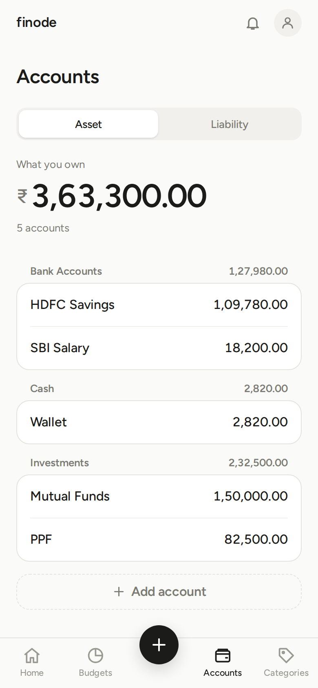
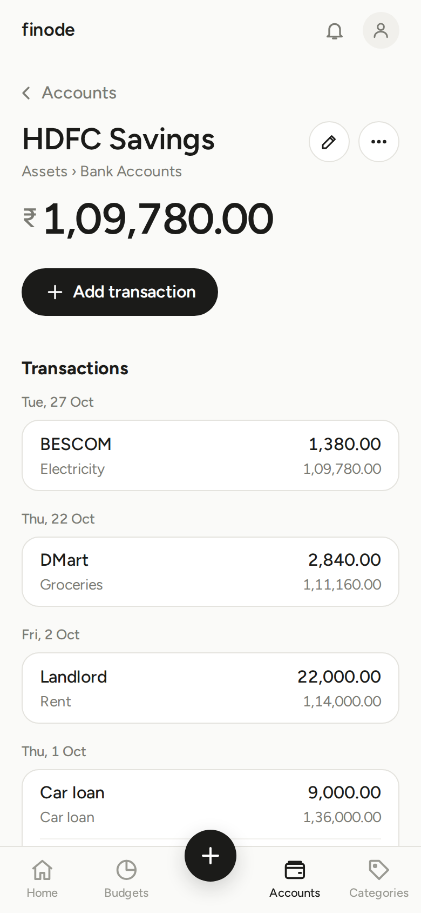
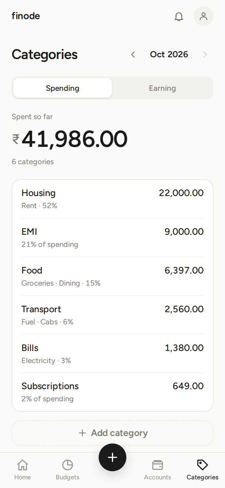

# Accounts and categories

## The idea

Money is always *somewhere* and always *for something*. finode keeps both as accounts in one tree:

- **Accounts** are where money is, and each is one of four kinds: a **Bank Account**, **Cash**, a **Credit Card** or a **Prepaid Wallet** (a meal card, FASTag, a gift card, an app wallet). Equity holds the system's *Opening Balances*; tap the chosen chip again to reach it, together with Expense and Income, the books' side of your categories.
- **Categories** are what money is for: Expenses (Food, Rent) and Income (Salary).

Every transaction moves an amount *from* one place *to* another, and the books stay balanced because both sides are recorded. You never have to think about debits and credits to use it.

## Money in and out, not what things are worth

finode follows your **cash flow**: what came in, what went out and where you stand. Every account you add is part of the budget, so there is nothing to switch on. Investments and loans are not accounts: a SIP, an EMI or an RD instalment is **spending** in a category such as *Investing* or *EMI*; a loan paid into your bank is **income** under *Borrowed*; selling an investment is income under *Redeemed*. (A home or car loan the bank pays straight to the seller needs nothing recorded: only the EMIs.)

## Accounts page

**Accounts** is one page, with a quiet count ("9 accounts") under the title. Your **pinned** accounts come first, each with its kind's icon. Under them, each of the four kinds has a large heading with its icon and the number of accounts in it ("4 accounts"), its total at the right, some space between one kind and the next, and a **list** of its accounts, one line each. The kinds come in your order (**Settings › Order of account types**; it starts Bank Account, Cash, Credit Card, Prepaid Wallet), and all four show even before they hold an account. Credit cards show what you **owe** ("22,570.00", with "owed" under it), never a minus sign. A line shows the account's name and its balance. It adds one quiet line only when there is something to say: a credit card with a bill says **Bill due 15 Nov** (in red once it is close or overdue); an account with no entry for a month says **No entry since 12 Sep**; an empty one says **No entries yet**. Every account shows: nothing runs past the edge of the screen. The last line of each list, **+ Add bank account** (or cash account, credit card, prepaid wallet), opens the form on that kind. Things to know:

- Every open account is listed, used or not. Closed ones are tucked behind one **Load more** button at the bottom (they carry a *closed* badge).
- An account belongs to its kind for good, and holds no accounts of its own.

### Add an account

Tap the add line at the end of a kind's list (**+ Add bank account**, for example). The form asks for a **Name**, the **Kind** (Bank Account, Cash, Credit Card or Prepaid Wallet; nothing is chosen unless you came from a kind's list), an optional **Current balance** (**Amount you owe now** for a credit card) and an optional note (behind *+ Add a note*). The balance is recorded as an *Opening balance* entry against the system's Opening Balances account, and you will see it in your transactions.

An account page shows its balance (the **+** at the bottom adds an entry for this account), a small **i** beside the name when you wrote a description for the account (tap it to read the note), a **…** menu (Edit, close it), and its transactions (the newest 30, then **Load more**). Entries dated in the future are in one **upcoming** card at the top of that list.

Each kind has its own icon, shown beside its heading, on your pinned accounts and when you choose a kind for a new account: a bank building for Bank Account, a banknote for Cash, a card for Credit Card and a wallet for Prepaid Wallet. A transfer between your accounts shows the icon of the account the money went into (paying your card bill shows the card). The kinds are headings, not pages: an account sits straight under Assets or Liabilities (as `Assets:HDFC` in an export) and the Accounts page groups it under its kind.

### Colours and signs on an account's page

- **Green with a `+`** is money coming into the account, or a **payment into a card** (it lowers what you owe).
- A **charge on a card** is plain, with no sign; the running balance beside each row shows which way it went.

### Credit cards

A credit card's balance is what you owe. A purchase on it is spending the day you swipe; paying the bill is a *transfer* from your bank account to the card.

### A card's bill

Give a credit card its **statement day** (the day of the month the bank closes the bill) and its **payment due day** when you add or edit it (31 means the last day of a shorter month; a due day earlier in the month than the statement day falls in the next month). Its page then shows the **Bill**: what you owed when the latest statement closed, less the payments and refunds since, with the due date ("Due in 3 days" in amber, "Overdue by 2 days" in red, "Paid" once it is covered). The purchases after the statement day are listed as *Spent since the statement*: they belong to the next bill. **Pay bill** opens the Add screen with the card as the account paid and the bill as the amount; you choose which account it comes from, and you can change the amount to pay a part. Nothing is stored for the bill: it is worked out from your entries, so it follows any change you make to them. A bill that is due within 5 days, or overdue, and not paid also appears under the **bell** ("Visa bill is due in 2 days", with **Pay bill**) and goes from it as soon as it is paid. The bank's own figure may differ from yours (a late posting, a fee): finode works the bill out from your entries. Two things bring it closer. A card that posts a line later than its date (see *The date a card posts a line* under Transactions) counts that line in the later statement. A card that rounds its bill can say how in **Round the bill** on its form (to the nearest rupee, or up to the next one): the Bill then shows the rounded figure with a **Rounded** row, and paying that amount settles it; the few paise left over carry into the next statement.

### Pin an account

Open an account and tap the pin button beside **…**. The Accounts page now starts with a **Pinned** list of the accounts you pinned, and each of them also stays in its own kind's list. Tap the button again to unpin. Pinning only chooses where an account is listed: your balances and budget do not change.

### Closing and deleting

An account that holds a balance cannot be closed. A closed account keeps its history but disappears from pickers; **Reopen** it any time. Closing is in the account's **…** menu. An unused account can be deleted for good. A closed account is listed under **Load more** on the Accounts page; open it to **Reopen**. Deleting is for good.

## Categories page

**Categories** shows one month at a time (never a future one; the month pill sits at the right of the title, as on Budgets: the arrows go back or forward, and tapping the month lets you pick any past month and year). Pick **Spending** or **Earning** (**Add category** is the dashed row at the end of the list; a deleted category that had history stays listed in the months it has amounts). The big figure is the month's total up to today (the whole month for a past one); it has no label, the Spending and Earning chips say which it is. Below it is a ranked list, biggest first, each row with its share of the month (0% for one with nothing in it; every row is the same height). Tap a row to see the category's page: the month's figure and its transactions. On a category's page the month pill sits beside the back link, and the round **+** on *Transactions* adds a transaction in this category. Use the arrows on the month pill to move between months.

Every category is listed, biggest first, including the ones with nothing in the month. To add one, tap **+ Add category** at the end of the list, give it a name and choose its **icon** (tap *Choose an icon* and pick one from the groups); every category has one, and it shows beside the category on Budgets, Categories, the Add screen and your transactions. Categories you had before icons came show a plain tag until you open one, tap **Edit** and choose. Categories are one flat list: a category holds no other categories.

**Deleting a category:** if it has never been used it is removed. If it has history it is *closed* instead: it leaves your lists and pickers but stays in the months where it has amounts. **Restore category** brings it back. Both are under the **…** menu.

## Notes

Names can be up to 40 characters, must be visible and on one line, cannot contain a colon (`:`), and must differ from the other accounts or categories in the same place (capitals do not count: `Food` and `food` are the same). Dates you can enter run from 1900 to 2999. A category can carry a short note, shown on the Budget.
