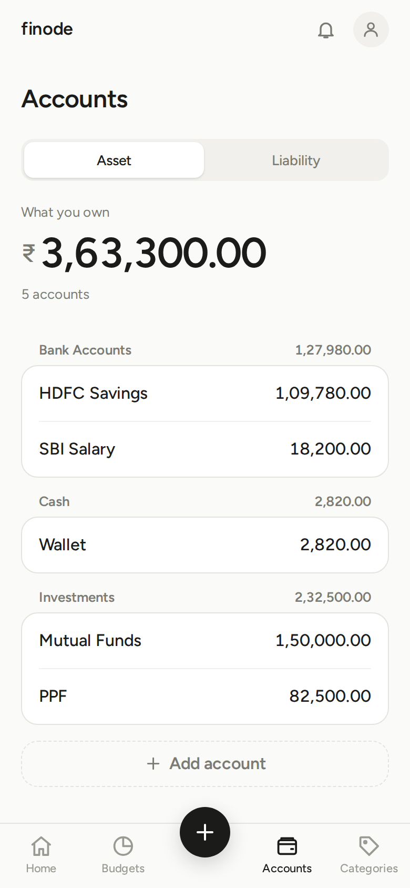
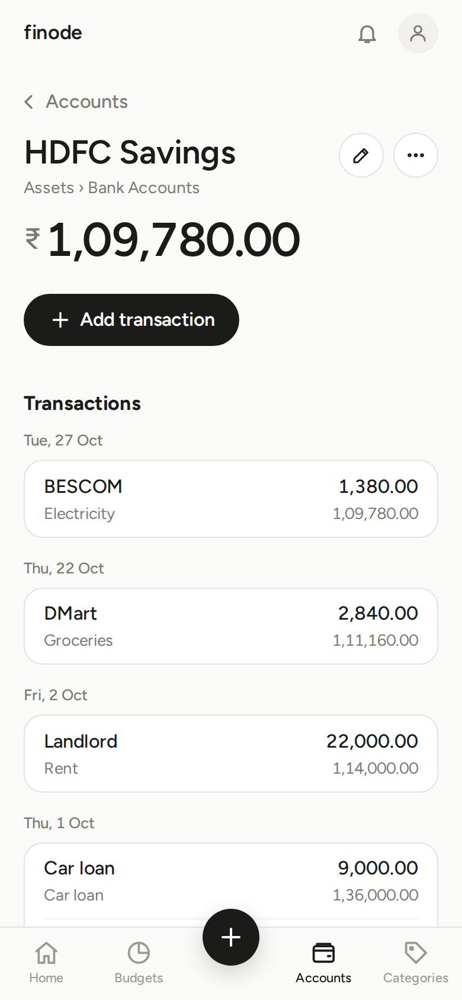
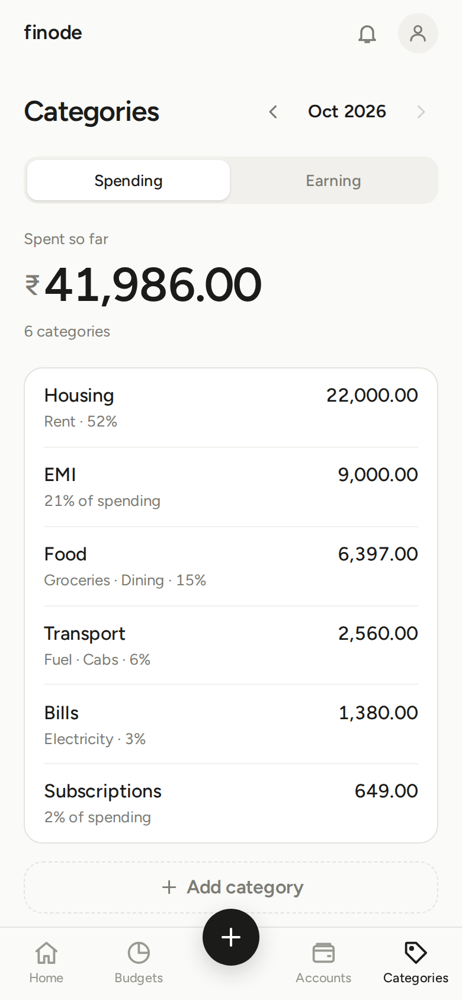

# Accounts and categories

## The idea

Money is always *somewhere* and always *for something*. finode keeps both as accounts in one tree:

- **Accounts** are where money is: Assets (bank, cash, wallet, investments) and Liabilities (credit cards, loans). Equity holds the system's *Opening Balances*; tap the chosen chip again to reach it, together with Expense and Income, the books' side of your categories.
- **Categories** are what money is for: Expenses (Food, Rent) and Income (Salary).

Every transaction moves an amount *from* one place *to* another, and the books stay balanced because both sides are recorded. You never have to think about debits and credits to use it.

## The built-in groups

If you signed up recently, your accounts start in five groups that are **built in**: under Assets, **Bank Accounts**, **Cash** and **Investments**; under Liabilities, **Credit Cards** and **Loans**. All five always show on the Accounts page, even before they hold an account. You cannot rename, move, close or delete the five kinds, but you can add as many accounts as you like in each, and you can still make groups of your own beside them (they show as kinds too).

The group tells finode what an account is, so you do not have to answer the budget questions: an account in Bank Accounts, Cash or Credit Cards starts **part of the budget**; one in Investments or Loans starts **outside the budget**. You can change either choice for one account with the **Part of the budget** box on its form. Accounts you made before this existed are not moved or renamed. Use **Kind** on an account's edit page to move it to another kind. Accounts are listed alphabetically.

## Accounts page

**Accounts** is one page. At the top is your **net worth** (what you own less what you owe) with a quiet count ("9 accounts"). Under it, every kind of account has a large heading with its total and the number of accounts under it ("2,54,880.50 · 4 accounts"), some space between one kind and the next, and a **row of cards**, one card per account, that you swipe sideways: **Bank Accounts**, **Cash**, **Credit Cards**, **Investments**, **Loans**, then any group you made yourself, then **Other** for accounts that belong to no kind. Credit cards and loans show what you **owe** ("22,570.00 owed"), never a minus sign. A card shows the account's name (with a small dot when it is part of the budget) and its balance. It adds one quiet line only when there is something to say: a credit card with a bill says **Bill due 15 Nov** (in red once it is close or overdue); an account with no entry for a month says **No entry since 12 Sep**; an empty one says **No entries yet**. A row with more cards than fit runs past the edge of the screen: swipe it sideways. The last card of a row, **+ Add account**, opens the form on that kind. Things to know:

- Every open account is listed, used or not. Closed ones are tucked behind one **Load more** button at the bottom (they carry a *closed* badge).
- Accounts go **two levels** deep, at most: a group and the accounts in it.

### Make a group

Tap **+ New group**, the dashed row at the end of the Accounts page. The form asks for a **Name**, **What it holds** (**Money I own** or **Money I owe**; it cannot be changed later) and **Part of the budget**: an account you make in the group starts with this choice, and you can still change it for any account. Nothing is chosen for you. A group has no balance of its own, so there is no balance field. The new group appears at once as its own row, even before it holds an account. On the group's page, **…** › **Edit** changes its name and the budget choice (accounts that already exist keep theirs), and **Delete group** removes it while it is empty.

### Add an account

Tap **+ Add account**, the dashed card at the end of a kind's row. The form asks for a **Name**, the **Kind** (Bank Accounts, Cash, Credit Cards, Investments, Loans or a group you made; nothing is chosen for you), an optional **Current balance** (**Amount you owe now** for a card or loan) and an optional note (behind *+ Add a note*). The balance is recorded as an *Opening balance* entry against the system's Opening Balances account, and you will see it in your transactions.

An account page shows its balance (the **+** at the bottom adds an entry for this account), a small **i** beside the name when you wrote a description for the account (tap it to read the note), a **…** menu (Edit, add a sub-account, close it), and its transactions (the newest 30, then **Load more**). Entries dated in the future are in one **upcoming** card at the top of that list.

Tap a group's name on the Accounts page (Bank Accounts, Cash, a group you made, and so on) to open the **group's page**. It shows the group's accounts as a row of cards you swipe, the dashed **+ Add account** card at the end, and below them the transactions of all the accounts in the group, each row naming its account. A group you made has a **…** menu with **Edit**, **Add account** and **Close group**; a built-in group has no menu, because nothing about it can be changed. A group is not posted to itself: open one of its accounts to record an entry for it.

### Colours and signs on an account's page

- **Green with a `+`** is money that raises an asset account, or a **payment into a card or loan** (it lowers what you owe).
- A **charge on a card** is plain, with no sign; the running balance beside each row shows which way it went.

### Credit cards and loans

A card or loan is a **liability**: its balance is what you owe. Paying the bill is a *transfer* from your bank account to the card. To have the budget count a card's purchases as spending, turn on **Part of the budget** when you add it (or later in its edit page). A payment into a card or loan outside the budget can carry a **category** on the Add screen, so an EMI counts as spending in that category.

### A card's bill

Give a card or loan its **statement day** (the day of the month the bank closes the bill) and its **payment due day** when you add or edit it (31 means the last day of a shorter month; a due day earlier in the month than the statement day falls in the next month). Its page then shows the **Bill**: what you owed when the latest statement closed, less the payments and refunds since, with the due date ("Due in 3 days" in amber, "Overdue by 2 days" in red, "Paid" once it is covered). The purchases after the statement day are listed as *Spent since the statement*: they belong to the next bill. **Pay bill** opens the Add screen with the card as the account paid and the bill as the amount; you choose which account it comes from, and you can change the amount to pay a part. Nothing is stored for the bill: it is worked out from your entries, so it follows any change you make to them. A bill that is due within 5 days, or overdue, and not paid also appears under the **bell** ("Visa bill is due in 2 days", with **Pay bill**) and goes from it as soon as it is paid. The bank's own figure may differ from yours (a late posting, a fee): finode works the bill out from your entries. Two things bring it closer. A card that posts a line later than its date (see *The date a card posts a line* under Transactions) counts that line in the later statement. A card that rounds its bill can say how in **Round the bill** on its form (to the nearest rupee, or up to the next one): the Bill then shows the rounded figure with a **Rounded** row, and paying that amount settles it; the few paise left over carry into the next statement.

### Pin an account

Open an account, then **…** › **Pin to top**. The Accounts page now starts with a **Pinned** row of the accounts you pinned, and each of them also stays in its own group's row, marked with a small pin. **Unpin** is in the same menu. Pinning only chooses where an account is listed: your balances and budget do not change. Groups cannot be pinned.

### Closing and deleting

An account that holds a balance cannot be closed. A closed account keeps its history but disappears from pickers; **Reopen** it any time. Closing is in the account's **…** menu. An unused account can be deleted for good. A closed account is listed under **Load more** on the Accounts page; open it to **Reopen**. Deleting is for good.

## Categories page

**Categories** shows one month at a time (never a future one; the month pill sits at the right of the title, as on Budgets: the arrows go back or forward, and tapping the month lets you pick any past month and year). Pick **Spending** or **Earning** (**Add category** is the dashed row at the end of the list; deleted categories are under Settings › Recently deleted). The big figure is the month's total up to today (the whole month for a past one); it has no label, the Spending and Earning chips say which it is. Below it is a ranked list, biggest first, each row with its three biggest subcategories and its share of the month (0% for one with nothing in it; every row is the same height). Tap a row to see the category's page: its subcategories and the month's transactions that were posted to that category itself (a subcategory's transactions are on its own page; the big figure still counts everything inside). On a category's page the month pill sits beside the back link; the round **+** on the *Subcategories* heading adds a subcategory and the one on *Transactions* adds a transaction in this category (a category with no subcategories has no such heading: use **…** › *Add subcategory*). Use the arrows on the month pill to move between months.

Every category is listed, biggest first, including the ones with nothing in the month. To add one, tap **+ Add category** at the end of the list. A category can have subcategories one level down (Food › Groceries), no further.

**Deleting a category:** if it has never been used it is removed. If it has history it is *closed* instead: it leaves your lists and pickers but stays in the months where it has amounts. **Restore category** brings it back. Both are under the **…** menu.

## Notes

Names can be up to 40 characters, must be visible and on one line, cannot contain a colon (`:`), and must differ from the other accounts or categories in the same place (capitals do not count: `Food` and `food` are the same). Dates you can enter run from 1900 to 2999. A category can carry a short note, shown on the Budget.
