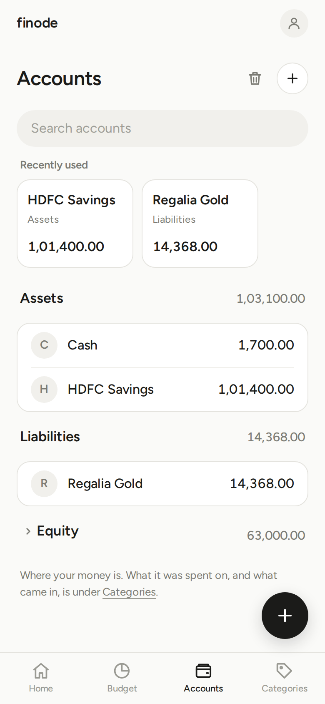
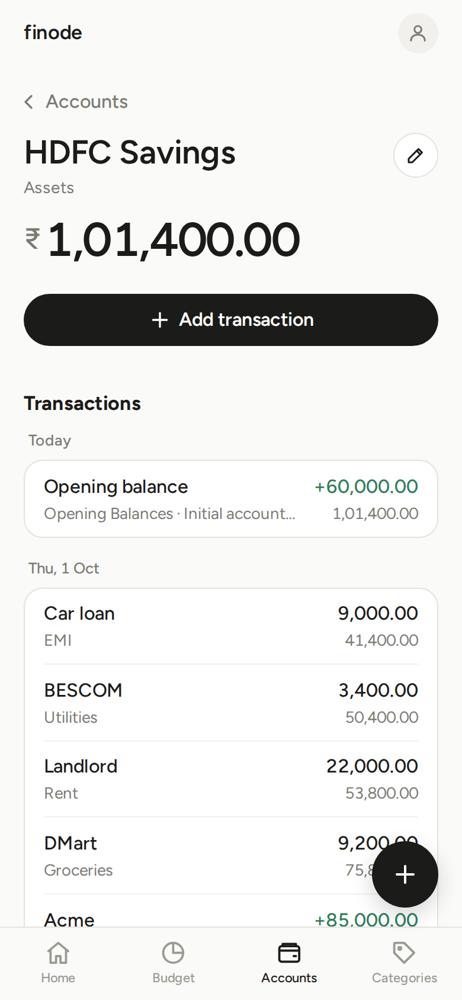
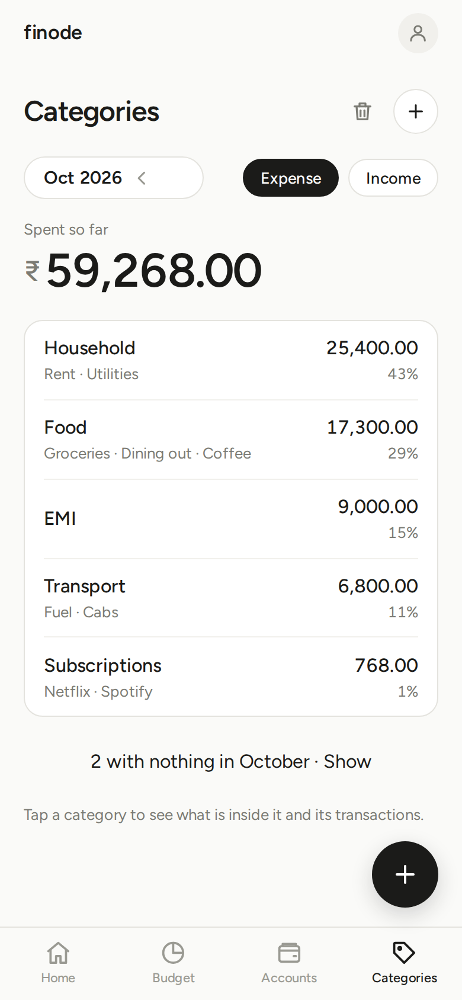

# Accounts and categories

## The idea

Money is always *somewhere* and always *for something*. finode keeps both as accounts in one tree:

- **Accounts** are where money is: Assets (bank, cash, wallet, investments) and Liabilities (credit cards, loans). Equity holds the system's *Opening Balances*; it has no chip, because almost nobody needs it (tap the chosen chip again, so that neither is chosen, to see it).
- **Categories** are what money is for: Expenses (Food, Rent) and Income (Salary).

Every transaction moves an amount *from* one place *to* another, and the books stay balanced because both sides are recorded. You never have to think about debits and credits to use it.

## The built-in groups

If you signed up recently, your accounts start in five groups that are **built in**: under Assets, **Bank Accounts**, **Cash** and **Investments**; under Liabilities, **Credit Cards** and **Loans**. A group appears on the Accounts page once it has an account in it; until then the page shows an **Add account** button. You cannot rename, move, close or delete the groups, but you can add as many accounts as you like inside each (from that button or the round **+** at the top of the page, which starts on the first group), and you can still make groups of your own beside them.

The group tells finode what an account is, so you do not have to answer the budget questions: an account in Bank Accounts, Cash or Credit Cards starts **part of the budget**; one in Investments or Loans starts **outside the budget**. You can change either choice for one account under *Budget options* on its form. Accounts you made before this existed are not moved or renamed. If you had an account before the groups existed, **Settings › Standard groups** adds them: it shows what will be added first, uses a group of yours that already has exactly that name (for example your own *Investments*), skips one that an account of yours is in the way of (rename your account first, then add it) and moves nothing. Then change **Under** on an account's edit page to move it into a group.

## Accounts page

**Accounts** has two chips, **Asset** and **Liability**, in that order, like Expense and Income on Categories. **Equity** has no chip: tap the chosen chip again, so that neither is chosen, and the page lists Equity. The chosen one shows a small label ("What you own"), its total as a large figure and a quiet count ("9 accounts"), then its accounts: each group (for example *Bank*) has a heading with its subtotal and its accounts under it; plain accounts (the ones not in any group) share one tile at the end, after all the groups, under the heading **Others** with their total (shown when the page also has a group). Things to know:

- Every open account is listed, used or not. Closed ones are tucked behind one **Load more** button at the bottom (they carry a *closed* badge).
- Accounts go **two levels** deep, at most: a group and the accounts in it.

### Add an account

Tap **+ Add account**, the dashed row at the end of the Accounts page. The form asks for a **Name**, **Under** (Assets for banks, cash and wallets; Liabilities for cards and loans; or a group you already made), an optional **Current balance** and an optional note (behind *+ Add a note*). The balance is recorded as an *Opening balance* entry against the system's Opening Balances account, and you will see it in your transactions.

An account page shows its balance, an **Add transaction** button, a pencil for Edit, a small **i** beside the name when you wrote a description for the account (tap it to read the note), a **…** menu when there is something in it (to add a sub-account, reorder the account or close it), and its transactions (the newest 30, then **Load more**). Entries dated in the future are in one **upcoming** card at the top of that list.

An account that has sub-accounts (such as a *Banks* group) is not posted to itself, so its page shows a **Sub-accounts** list with each balance instead; open one to see its transactions. The **+** beside the heading adds another.

### Colours and signs on an account's page

- **Green with a `+`** is money that raises an asset account, or a **payment into a card or loan** (it lowers what you owe).
- A **charge on a card** is plain, with no sign; the running balance beside each row shows which way it went.

### Credit cards and loans

A card or loan is a **liability**: its balance is what you owe. Paying the bill is a *transfer* from your bank account to the card. To have the budget count a card's purchases as spending, turn on **Part of the budget** when you add it (or later in its edit page). A card or loan outside the budget can name a **payment category**, chosen in the same form, so an EMI counts as spending in that category.

### Closing and deleting

An account that holds a balance cannot be closed. A closed account keeps its history but disappears from pickers; **Reopen** it any time. Closing is in the account's **…** menu. An unused account can be deleted for good. Both can be brought back from **Settings › Recently deleted**.

## Categories page

**Categories** shows one month at a time (never a future one; the month pill sits at the right of the title, as on Budgets: the arrows go back or forward, and tapping the month lets you pick any past month and year). Pick **Expense** or **Income** (**Add category** is the dashed row at the end of the list; deleted categories are under Settings › Recently deleted). The big figure is the month's total up to today (the whole month for a past one); it has no label, the Expense and Income chips say which it is. Below it is a ranked list, biggest first, each row with its three biggest subcategories and its share of the month (0% for one with nothing in it; every row is the same height). Tap a row to see the category's page: its subcategories and the month's transactions that were posted to that category itself (a subcategory's transactions are on its own page; the big figure still counts everything inside). On a category's page the month pill sits beside the back link; the round **+** on the *Subcategories* heading adds a subcategory and the one on *Transactions* adds a transaction in this category (a category with no subcategories has no such heading: use **…** › *Add subcategory*). Use the arrows on the month pill to move between months.

Every category is listed, biggest first, including the ones with nothing in the month. To add one, tap **+ Add category** at the end of the list. A category can have subcategories one level down (Food › Groceries), no further.

**Deleting a category:** if it has never been used it is removed. If it has history it is *closed* instead: it leaves your lists and pickers but stays in the months where it has amounts. **Restore category** brings it back. Both are under the **…** menu and in **Settings › Recently deleted**.

## Notes

Names can be up to 40 characters, must be visible and on one line, cannot contain a colon (`:`), and must differ from the other accounts or categories in the same place (capitals do not count: `Food` and `food` are the same). Dates you can enter run from 1900 to 2999. A category can carry a short note, shown on the Budget.
