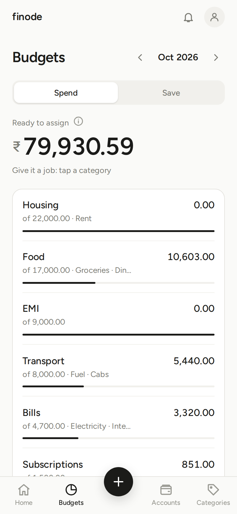
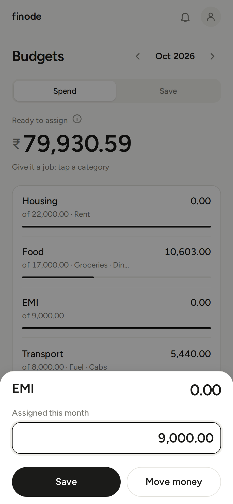

# Budgeting and Budgets

The tab is called **Budgets**. It lists the categories you spend from.

finode uses **envelope budgeting**: you give every rupee in your budget accounts a job (a category), and you spend from the category. When a category is empty you either move money in from another one or you overspend, and the app shows it.

Budgets are **monthly**.

## The words

| Word | Meaning |
|---|---|
| **Budget accounts** | Every account you add: your bank accounts, cash, credit cards and prepaid wallets. There is nothing to switch on. |
| **Assigned** | How much you gave a category this month. |
| **Spent** (activity) | What you spent in the category this month, from budget accounts. |
| **Left** (available) | What you can still spend: last month's leftover (if any) + assigned − spent. |
| **Ready to assign** | Money in budget accounts that has no job yet. |

The page opens with one figure: **Ready to assign** (tap the **i** beside it for the sum). Your aim is to bring it to zero: *every ₹ has a job*. *Left to spend* and its bar are on Home, not here.

Tap the **i** beside the figure (on the Budgets page, and on Home's *Left to spend*) to see how it is worked out with your own numbers: for example, money in your accounts, minus what is set aside for card bills, minus what is left in your categories, minus what you assigned to later months.

## A worked example

You have ₹50,000 in your bank account, and no budget yet.

1. Ready to assign: **₹50,000**.
2. You assign Rent ₹20,000, Groceries ₹8,000 and Transport ₹2,000. Ready to assign: **₹20,000**.
3. You spend ₹3,000 on groceries. Groceries shows **₹5,000 left**; Ready to assign is unchanged.
4. Next month, the unspent ₹5,000 stays in Groceries (it carries over), and you assign fresh money on top.

## The warnings

- **Amber "Over-assigned by X"** (under the figure): you assigned more than you have. Ready to assign shows ₹0.00. Lower an assignment.
- **Red "Overspent by X"**: you spent more than there was to spend across *all* categories together. A single overspent category is not a warning; its own bar shows it in red.
- **Overspending carries a cost**: an overspent category starts next month at zero and the deficit is taken out of Ready to assign from then on. Cover it by moving money from another category.

## Using the page

- Use the arrows around the month at the top (**‹ Oct 2026 ›**) to look at the next or previous month, including future ones, or tap the month itself to pick any month and year.
- The list is ranked, **biggest budget first**. Each row has a bar showing how much is spent, with a small **notch marking how far through the month today is**: a bar ahead of the tick means you are spending faster than the month passes.
- Every category is one row. Tapping it opens a **sheet** with **Assigned this month** (type the amount and **Save**), what was **Spent**, and **Move money** to another category.

- Budgets looks at the **whole month**, so an entry dated later this month already counts as spent in its category, while Home's Transactions list, account balances count up to today.
- **Move money** never changes Ready to assign; it limits you to what the source category has left. Typing a smaller (even negative) amount in a category's *Assign* field takes money back to Ready to assign, but never more than the category has left.
- **Ready to assign is as of today.** Payments dated later this month, and the ones a recurring rule will record, are not in the figures until their day. Open the ⓘ beside Ready to assign: the last line says how many are coming up by the end of the month and what they come to, and opens **Coming up**, one list of entries you dated ahead and what your recurring transactions will record (those are marked *Repeats*). An account's own page says what its balance will be after the entries dated ahead.
- What needs a decision is under the **bell** at the top of every page (a number beside it when something is waiting): recurring transactions that could not be recorded, and credit card bills due within 5 days or overdue. Each item has its fix on the spot. On a month with nothing assigned yet (the link goes as soon as anything is assigned), a quiet **Copy last month's amounts** link sits under the figure.
- **Copy last month's amounts** assigns each category what it got last month, but only where nothing is assigned yet.

### Credit cards, loans and EMIs

- Purchases on a **credit card** count in their category the day you swipe. Paying the card is a transfer and is not "spending" again.
- A **loan** is not an account. An EMI is an expense: record it from the bank account it leaves, in a category such as *EMI*. A loan paid into your bank is income under *Borrowed*; one the lender pays to the seller (a home or car loan) needs nothing recorded.

## Home vs Budgets

Home shows one number, *Left to spend in <month>*, with a thin bar: the total left across your categories. A month picker sits at the top right (any past month; never a future one); a small notch under the bar marks how far through the month today is. Before you have assigned anything it shows what you have spent this month and a link to set up the budget. Under it Home shows, once you have recorded something: a line when a category is overspent, and last your latest transactions. The Plan page is for *deciding*, Home is for *glancing*.

## If numbers disagree

**Budgets**, the **Categories** page and the overview count an EMI or a SIP the same way: as spending in its category. The Budget leaves out on purpose what no budget account paid (money moving only between you and a person, say).

## Paying into a fund or a loan

Money you put into a mutual fund each month, or an EMI you pay on a loan, is money out like any other spending. Make a category such as *Investing* or *EMI*, plan it, and record each payment as an expense in it from the account it leaves. Ready to assign falls when you plan it and the category shows what you have paid. When a fund pays you back, record it as income under *Redeemed*.
