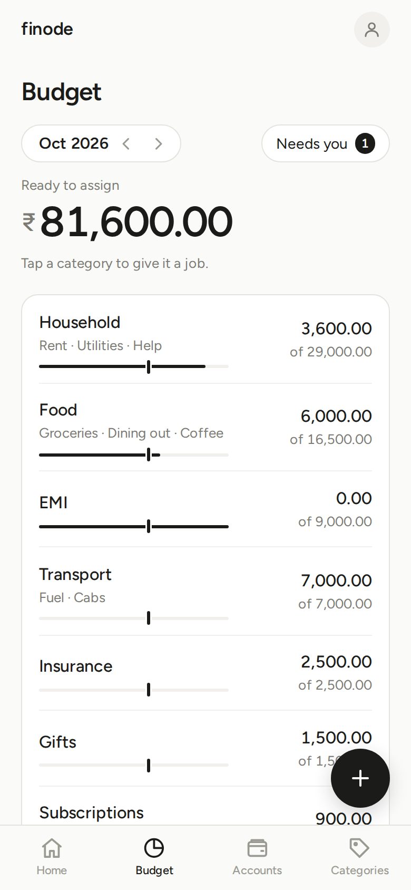
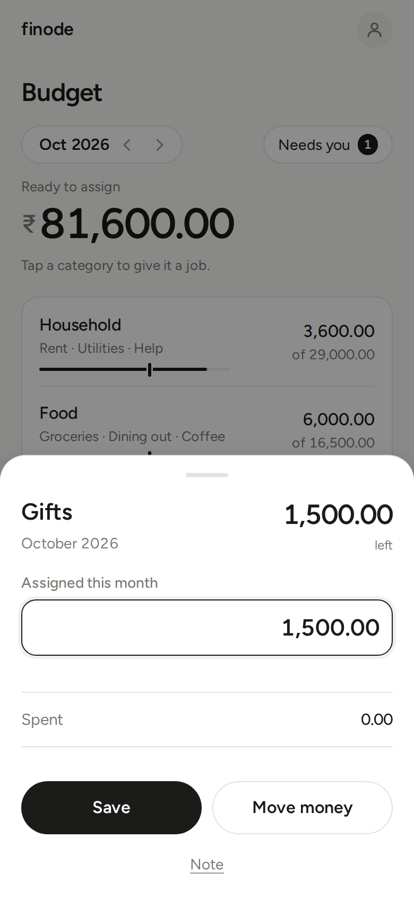

# Budgeting

finode uses **envelope budgeting**: you give every rupee in your budget accounts a job (a category), and you spend from the category. When a category is empty you either move money in from another one or you overspend, and the app shows it.

Budgets are **monthly**. (Weekly and yearly *targets* exist behind the Advanced switch.)

## The words

| Word | Meaning |
|---|---|
| **Budget accounts** | The bank, cash and card accounts whose money you budget. When you add an account you pick its **type** (Bank, Cash, Credit, Loan, Investment, Property, Other); the type sets **Part of the budget**: on for Bank, Cash and Credit, off for the rest. Change it under *More options* on the form, or later on the account's edit page. |
| **Tracking accounts** | Accounts outside the budget (say, a long-term investment or a loan). They count in net worth but their money is not yours to assign. |
| **Assigned** | How much you gave a category this month. |
| **Spent** (activity) | What you spent in the category this month, from budget accounts. |
| **Left** (available) | What you can still spend: last month's leftover (if any) + assigned − spent. |
| **Ready to assign** | Money in budget accounts that has no job yet. |

The page's main figure is **Ready to assign in <month>**. Your aim is to bring it to zero: *every ₹ has a job*.

Tap the **i** beside the figure (on Budget and on Home's *Left to spend*) to see how it is worked out with your own numbers: for example, money in your accounts, minus what is set aside for card bills, minus what is left in your categories, minus what you assigned to later months.

## A worked example

You have ₹50,000 in your bank account, and no budget yet.

1. Ready to assign: **₹50,000**.
2. You assign Rent ₹20,000, Groceries ₹8,000 and Transport ₹2,000. Ready to assign: **₹20,000**.
3. You spend ₹3,000 on groceries. Groceries shows **₹5,000 left**; Ready to assign is unchanged.
4. Next month, the unspent ₹5,000 stays in Groceries (it carries over), and you assign fresh money on top.

## The warnings

- **Amber "Over-assigned by X"**: you assigned more than you have. Ready to assign shows ₹0.00. Lower an assignment.
- **Red "Overspent by X"**: you spent more than there was to spend across *all* categories together. A single overspent category is not a warning; its own bar shows it in red.
- **Overspending carries a cost**: an overspent category starts next month at zero and the deficit is taken out of Ready to assign from then on. Cover it by moving money from another category.

## Using the page

- Use the arrows around the month at the top (**‹ Oct 2026 ›**) to look at the next or previous month, including future ones, or tap the month itself to pick any month and year.
- The list is ranked, **biggest budget first**. Each row has a bar showing how much is spent, with a small **tick marking how far through the month today is**: a bar ahead of the tick means you are spending faster than the month passes.
- A **group** (like Food) shows the total of its subcategories; tap it to open its own page. A plain category, or a row on a group's page, opens a **sheet** with **Assigned this month** (type the amount and **Save**), what was **Spent**, **Move money** to another category, and the **Note** (and, with Advanced on, the target). On a group's page, tap the figure at the top to set the group's own budget: it starts at what its subcategories add up to, you can raise it, and a lower amount is refused (the field turns red).

- The Budget looks at the **whole month**, so an entry dated later this month already counts as spent in its category, while Home's Transactions list, account balances and the Month summary count up to today.
- **Move money** never changes Ready to assign; it limits you to what the source category has left. Typing a smaller (even negative) amount in a category's *Assign* field takes money back to Ready to assign, but never more than the category has left.
- Behind the **Needs you N** badge are the things that need a decision: accounts left out of the budget, last month's overspending, *Copy last month's amounts*, and (Advanced) *Assign what is needed*.
- **Copy last month's amounts** assigns each category what it got last month, but only where nothing is assigned yet.
- The **credit accounts** row (a collapsible card on Home, before the transactions, like the upcoming card on Transactions) shows what you owe on budget credit cards, with the month's charges and payments. You do not assign to cards; their debt is already set aside from your cash.

### Credit cards, loans and EMIs

- Purchases on a **budget credit card** count in their category as you buy. Paying the card is a transfer and is not "spending" again.
- A card that is *not* part of the budget: purchases on it are not counted; the Budget offers *Add to budget* for it.
- A **loan** outside the budget can name a **payment category** (on its edit page). A payment to the loan from a budget account then counts as spending in that category, so an EMI uses the category instead of silently lowering Ready to assign. Interest the lender charges is not part of the budget.

## Targets (Advanced)

With **Settings › Advanced** on, each category's target page lets you say what you want: **Monthly** (X every month), **Weekly** (X for each chosen weekday), **Refill** (keep X available), **By date** (X saved by a month), **Yearly** (X every year, in a month). A line then shows what it **needs**, and **Assign what is needed** assigns the missing amounts, in display order, until Ready to assign runs out.

## Home vs Budget

Home shows one number, *Left to spend in <month>*, with a thin bar: the total left across your categories. A month picker sits at the top right (any past month; never a future one), and under the bar three columns show what you *Earned*, *Assigned* and *Spent* in that month; tap them for that month's Summary. Before you have assigned anything it shows what you have spent this month and a link to set up the budget. Under it Home shows, once you have recorded something: a line when a category is overspent, and last your latest transactions. The Budget page is for *deciding*, Home is for *glancing*.

## If numbers disagree

The **Budget**, the **Categories** page, the **Month summary** and the overview all count a loan payment the same way: as spending in the loan's payment category. They differ only in what the Budget leaves out on purpose: it counts what your budget accounts paid, so interest a lender adds to a loan (which no budget account paid) shows up as an expense in the reports but not in the Budget.
