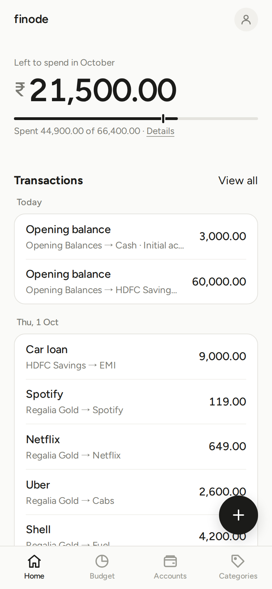
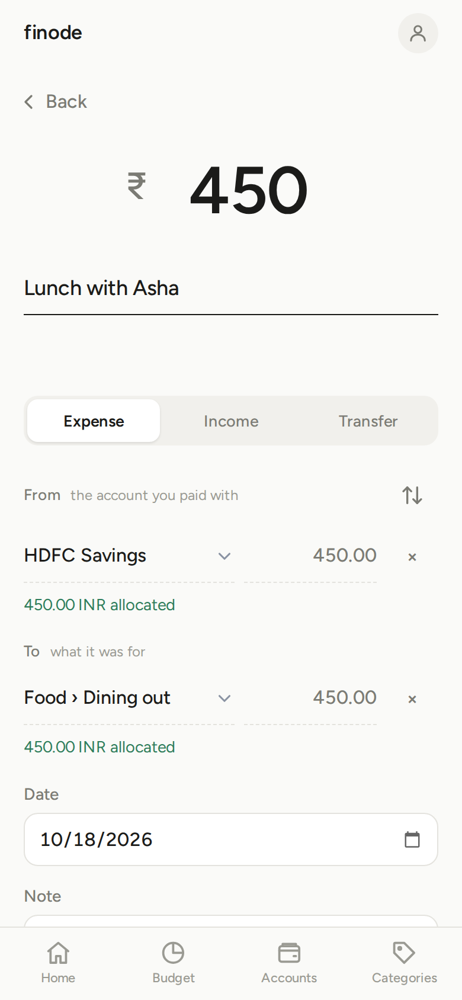

# Getting started

finode is a personal money tracker that works like a bank's books (double entry) but looks like a simple app. This page takes you from nothing to your first recorded expense.

## 1. Sign up and sign in

Sign-up is by invitation: you need the invite code you were given. Open the site, choose *Sign up*, enter your email, a password and the code. When a test is being run, you also tick a box to confirm you have read the notice (a person runs this, your data is technically reachable by them but not looked at, data may be reset, and nothing here is financial advice).

If your installation has password reset turned on, the sign-in page has a *Forgot password* link.

## 2. Check your currency

Everything in finode is in **one currency**, INR (₹) unless you change it in **Settings › Currency**. Do this *before* adding accounts. Changing it later only changes the label; no amounts are converted.

## 3. The three steps on Home

A new Home screen shows **Get started** with three steps:

1. **Add a bank account, cash or card.** Give it a name and today's balance. The balance is recorded as an *Opening balance* entry, which you will see in the Transactions list on Home and on the Transactions page.
2. **Add an expense category**, like Groceries.
3. **Record your first transaction.**

Steps tick off as you do them, and the card disappears when all are done.

## 4. Find your way around

On a phone, the bottom bar has four tabs and a floating **+**:

| Tab | What it is for |
|---|---|
| **Home** | one number (what is left to spend this month) and your recent transactions |
| **Plan** | give every rupee a job (Spend), plan what you save (Save) and what you expect to earn (Earn); see what is Ready to assign |
| **Accounts** | where your money is: banks, cash, cards, loans |
| **Categories** | what you spend on and earn from, and how much, month by month |
| **+** | add a transaction |

On a wide screen a sidebar replaces the bar and the **+** (it has a *New transaction* button). **Transactions** (the full list) has no tab: use *View all* on Home or the sidebar. **Settings** is the round person icon at the top right on phones and the link at the bottom of the sidebar on wide screens; your **Profile** (name, AI assistants, your data, sign out) is one tap from there.

## 5. Your first expense

1. Tap **+**.
2. Type the **amount** at the top.
3. Optionally type a **payee** (who you paid).
4. Keep **Expense** selected (the default), then choose **From** (the account you paid with) and **To** (what it was for, such as Groceries). You can create an account or category right there with *+ New account…*.
5. Change the **date** if it was not today, and add a **note** if you like.
6. **Save**, or **Save & add another** to keep entering.

After a few entries, tapping a payee chip under the payee field fills in the same accounts as last time.

## Where next

- [Accounts and categories](accounts-and-categories.md)
- [Transactions](transactions.md)
- [Budgeting](budgeting.md)
- [Recurring transactions, settings and backup](recurring-and-settings.md)
- [Using finode from an AI assistant](mcp.md)
