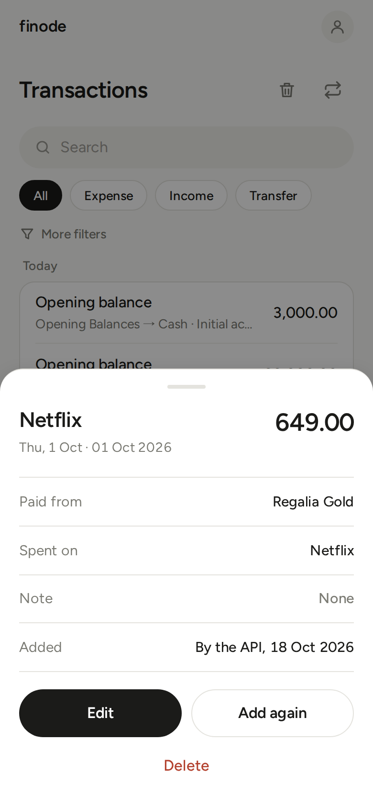

# Transactions

A transaction is money moving from one or more places to one or more places. Every one is recorded in a way that always balances.

## Adding one

Tap **+** (phone) or **New transaction** (wide screen).

1. **Amount**: type it at the top. The amount field cleans itself as you type: only digits, one decimal point and a leading minus are kept, so `42.00.00` cannot happen. On a phone, tap the amount to open the keyboard. Amounts are grouped as you type (1,24,500 for rupees).
2. **Kind**: **Expense** (the default), **Income** or **Transfer**. The kind only narrows the account lists:
   - Expense: from an account or card, to a category.
   - Income: from an income category, to an account.
   - Transfer: between your own accounts (including paying a card or a loan).
   - Tap the selected kind again to select *none*: every account is offered. Use this for anything unusual.
3. **From** and **To**: pick the accounts. Choose *+ New account…* to create one without leaving the form.
4. **Payee**, **note** and **date** (a chip that reads "Today, 24 Oct"; tap it to pick another day).
5. **Save**, or **Save & add another** to keep entering.

### Payee chips

Under the payee field, finode suggests the payees you use most. Tapping one fills the payee, the kind and the accounts you used last time for that payee and moves you to the amount. Typing a payee in full does the same quietly.

### Splitting across accounts

When you need more than one account on a side (a bill paid half by cash and half by card, or a shop receipt with Food and Household), add rows. Each side starts with one row; when you type a different amount in a row, a new row appears with the remainder suggested, until the side adds up to the total. Both sides must add up to the same total. The same account cannot be on both sides of one entry (money cannot move from an account to itself); it can appear on several rows of the same side.

### Repeat

**Tags.** A tag is a label on an entry (`goa-trip`, `reimbursable`, `emi`), apart from its note. Under the note, the **Tags** row opens a sheet: search your tags, tap to tick or untick them, or type a new word and tap **Create**. The ones you chose show as chips; ✕ takes one off. A tag is one word of letters, digits, `-` or `_` (up to 30), and `#EMI` and `emi` are the same tag. An entry can have up to 10. A `#` you type in the note is just text.

In the app: a row shows the note and, after it, its tags (`HDFC Card · Airport drop · #goa-trip`). The details sheet has a **Tags** row; tap a tag to see that month's entries that carry it. The **Filter** sheet has a **Tag** row that opens a searchable list of your tags (how many entries, the last day, and what they come to when they all go one way); with a tag chosen, the line under the title adds up what the entries came to ("12 transactions · 43,200.00 spent"), and the ✕ removes the filter. **Settings › Your data › Tags** lists all your tags: tap one to **rename** it (a misspelling is fixed once, for every entry), **merge** it into another tag, or **delete** it (the entries stay, only the label goes). A tag that no entry carries any more disappears by itself.

**Where an entry came from.** An entry that an assistant recorded from a bank message or a mail can carry its source and reference; the details sheet then shows a quiet *Source* line (a link when there is one). A source's reference is used once, so the same message is never recorded twice.

Open a transaction and tap **Repeat** (under Edit) to start a new one pre-filled with the same accounts, payee and note, dated today.

### Related entries

A refund, a reversal or a cash-back belongs with the purchase it follows. Open the original and tap **Related** (under Edit): a new, empty entry opens with a "Related to…" line above Save, and you fill it in as usual. From any form you can also tap **Related transaction** and pick one from a searchable list, which is how to link something you have already recorded (the ✕ on the line takes the link off, on a new entry or when editing).

Both entries show the link in their details sheet: the new one says "Related to" the original, the original lists what is related to it, and tapping either opens the other. A link is only a link: it changes no amounts, balances or budget, and deleting the original simply drops it.

## The Transactions page

**View all** on Home (or the sidebar) opens the full list, grouped by day.

- The **month pill** at the top right (the same place as on Budgets and Categories) picks the month: the arrows go back or forward, and tapping the month opens a month and year picker. Entries dated ahead wait in the *upcoming* card on the current month.
- **Filter** (the word at the right of the line under the title): opens a sheet with **Account**, **Category** and **Merchant**; each opens a searchable list, **Show transactions** applies them (a field left on Any is not sent). What is set shows under the line with a ✕ to remove it, and the line says how many entries match and what they come to when they all go one way ("3 transactions · ₹2,338 spent"). The filters apply to the month in the pill. Recurring transactions and Recently deleted are in Settings › Your data.
- **Tap a row** (on this page, Home, and on an account's or a category's own page) to see its details in a sheet: the accounts (*Paid from* and *Spent on* for an expense), the note (only when there is one), the entries related to it, a quiet line above the buttons when an assistant added it (*Added by Claude*, with a sparkle) or a recurring rule did (*Recurring*; nothing is said for what you entered yourself), the **Edit** button, two round icon buttons (**Repeat** and **Related**, named for screen readers and as a hover tip) and **Delete**.

- A month starts with its newest 25 entries (a day is never cut in two); **Show 25 more** at the bottom of the list adds the next ones in place, with how many are left beside it, until the whole month is on the page. **Home** does the same, starting with the newest 8 and adding 10 at a time.

### Upcoming entries

An entry dated in the future (a loan instalment, a bill you entered ahead) is **not history**. It does not appear in the Transactions list on Home, and it does not change balances until its date. On the Transactions page, and on an account's page, all of them sit in **one collapsed card**: *N upcoming · X in all*. Open it for a statement of dates, payees and amounts, soonest first.

## Editing and deleting

Open a row and tap **Edit**.  **Delete** removes it at once and the toast offers **Undo** for a few seconds (the entry also waits in Recently deleted).

### Recently deleted

Deleted by accident? Open **Settings › Your data › Recently deleted** (it also lists accounts and categories): it lists what was deleted, newest first, each with **Restore**. A restored entry comes back with its old details (it is checked again, so a closed account will stop it, and tell you why). Only the latest deletion of an entry can be restored, and a restored entry is no longer linked to the recurring rule that made it. Its **related** links come back: to the earlier entry it was related to, and from the entries that were related to it (unless that entry is gone, got another link meanwhile, or the link would make a circle).

## How amounts look

- Ordinary spending shows no minus sign, so a long list is not a column of signs. Income is `+` and green. Transfers are plain.
- A real negative (an overdrawn account, an overspent category, a debt) keeps its `−` and red.
- In **INR** amounts are grouped the Indian way (`12,34,567.00`), with `₹` in front of large figures. Other currencies are grouped in thousands.
- Text coloured **blue** under a row (*Recurring*, *Added by Claude*) was added automatically.
